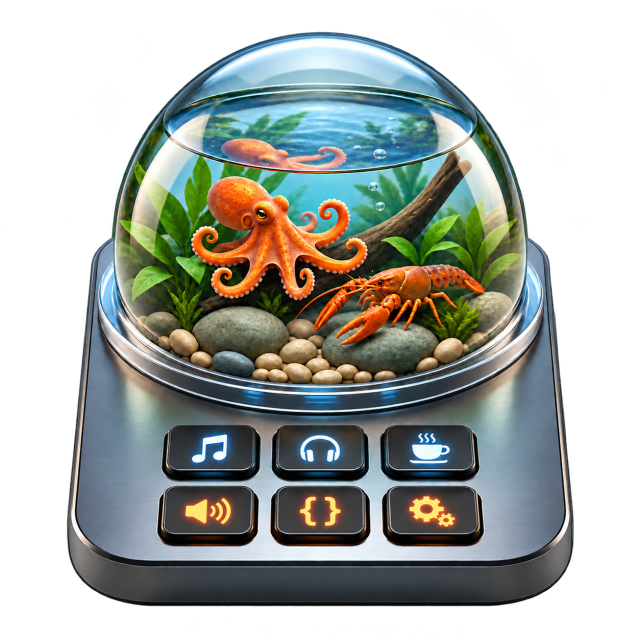
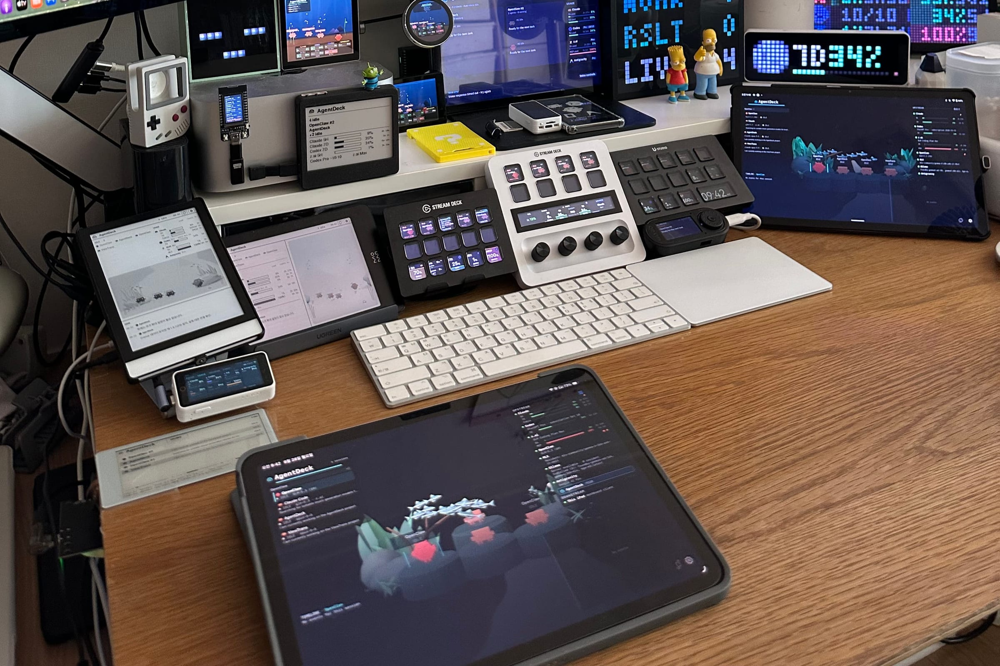
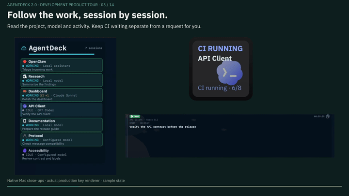
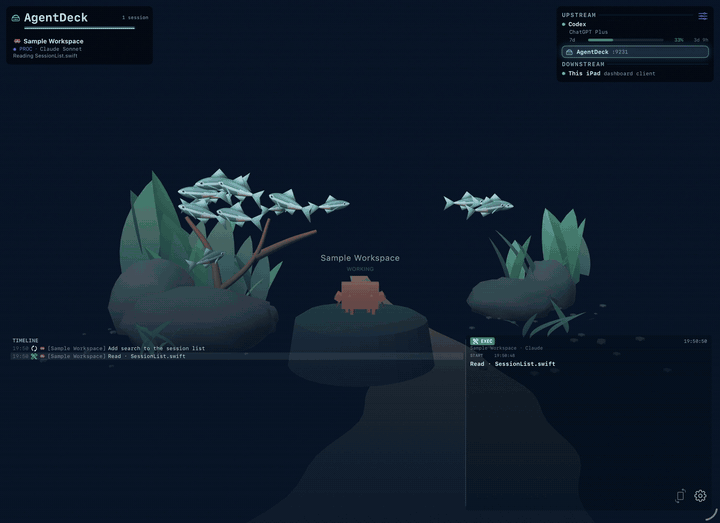

<p align="center">
  
</p>

# AgentDeck

<p align="center">
  <a href="https://apps.apple.com/app/id6784822497?pt=128040795&ct=github-readme-202610&mt=8"></a>
  <a href="https://play.google.com/store/apps/details?id=dev.agentdeck"></a>
  <a href="https://marketplace.elgato.com/product/agentdeck-dce3806b-176e-40f2-be7d-e029bec0f464"></a>
  <a href="https://ugc.ulanzistudio.com/contentView/1239890184745660416"></a>
  <a href="integrations/vobot/README.md#gallery-release"></a>
  <a href="LICENSE"></a>
  <a href="https://www.npmjs.com/package/@agentdeck/setup"></a>
  <a href="https://github.com/puritysb/AgentDeck/actions/workflows/ci.yml"></a>
  <a href="https://puritysb.github.io/AgentDeck/"></a>
</p>

**Your AI agents, at a glance. Across your desk.**

AgentDeck brings your AI agents into one local dashboard. See which are working, waiting for you, or finished—across
projects and tools. Watch them in a living aquarium, follow the timeline, and
keep usage limits in view. Use your Mac or terminal on its own, or add a tablet,
Stream Deck, e-ink reader, or small desk display.

<p align="center">
  <a href="docs/media/desk-overview.jpg"></a>
</p>

*Photographed on September 28, 2026. [See the full desk](docs/media/desk-overview.jpg).*

**Start with what you already have. No extra hardware required.**
Use your Mac or terminal on its own, then add the displays that fit your desk.

[**Get started →**](#start-here) · [**Choose your view ↓**](#choose-your-view) ·
[Watch the hardware desk tour](https://youtu.be/s-f8ICBcC4o)

<p align="center">
  <a href="https://puritysb.github.io/AgentDeck/#product-tour"><strong>▶ Watch the AgentDeck product tour</strong></a>
  &nbsp;·&nbsp;
  <a href="https://puritysb.github.io/AgentDeck/"><strong>🌊 Project website</strong></a>
  &nbsp;·&nbsp;
  <a href="https://puritysb.github.io/AgentDeck/hardware/">Devices</a>
  &nbsp;·&nbsp;
  <a href="https://puritysb.github.io/AgentDeck/demo/">Live preview</a>
  &nbsp;·&nbsp;
  <a href="https://puritysb.github.io/AgentDeck/design-system/">Design system</a>
</p>

## AgentDeck · 2.0 product tour

[](https://puritysb.github.io/AgentDeck/#product-tour)

A **2 minute 24 second** tour of the whole workflow: parallel agent sessions,
per-session history and CI waiting, collaboration, usage windows, original choices
and one-time approval, voice and native agent controls, task evaluation and
recorded evidence, then the roles of keypads, tablets, e-ink and small displays.

Actual Mac/iPad UI and production renderers use fictional activity; the phone
control chapter uses a real local OpenCode execution. Static captures and older
hardware photographs are labeled in the video. It was recorded on
2.0 builds, with English, Korean and Japanese captions; released downloads retain
their channel versions. CloudKit/Watch remains a separate development experiment.

[Watch the captioned product tour](https://puritysb.github.io/AgentDeck/#product-tour) ·
[Choice and approval detail](https://puritysb.github.io/AgentDeck/#controller-workflow) ·
[Aquarium detail](https://puritysb.github.io/AgentDeck/#current-habitat) ·
[Device captures](https://puritysb.github.io/AgentDeck/hardware/#current-captures) ·
[Media provenance](docs/media/current/manifest.json)

Historical photographs and earlier recordings remain available. The device gallery
labels its AI-assisted photo composite separately from actual app and firmware captures.

## Start here

**No extra hardware required.** Choose a native dashboard or the terminal path.

### Mac, iPhone, and iPad

[Install from the App Store](https://apps.apple.com/app/id6784822497?pt=128040795&ct=github-readme-202610&mt=8).
The Mac app includes its own daemon and needs no Node.js. Enable your agent
integrations in Settings, then run your agents normally. iPhone/iPad pair with
an AgentDeck daemon on your network.

Requires macOS 26+ or iOS/iPadOS 17+. See the [Apple guide](docs/apple-app.md).

### Terminal, Windows, Linux, and external integrations

Requires Node.js **22, 24, or 26** and a supported agent on macOS 15+,
[Windows 11](docs/windows.md), or [Linux](docs/linux.md).

```bash
npx @agentdeck/setup
agentdeck daemon install   # refresh hooks and start observation
claude                     # or: codex · opencode · kiro-cli
```

In another terminal:

```bash
agentdeck dashboard        # live sessions, aquarium, usage, and timeline
```

The Mac app can also attach to the CLI daemon for additional integrations,
including Claude subscription gauges and ADB device support.
[Compare capabilities](docs/appstore-feature-matrix.md).
For setup problems, run `agentdeck diag agents` or see
[installation](docs/install.md) and [troubleshooting](docs/troubleshooting.md).

<details>
<summary>Existing managed sessions and remote attach</summary>

`agentdeck claude`, `agentdeck codex`, `agentdeck opencode`, and
`agentdeck monitor` are a long-term compatibility path; no removal is planned.
Ordinary local sessions should use the daemon with normal agent commands.
Daemon-first equivalents exist for launch arguments (`agentdeck run`), deck
ordering (`agentdeck order`) and remote sessions (`agentdeck relay`,
experimental). Immediate terminal steering stays managed-only. See the
[CLI reference](docs/cli.md),
[remote attach guide](docs/daemon.md#remote-attach-cross-machine-sessions), and
[decision record](docs/managed-replacement-inventory.md#october-15-decision).

</details>

## Choose your view

Start with your Mac or terminal; add screens and controls as needed.
Mobile apps and hardware connect to a daemon on your computer.

| Surface | What it offers | Setup |
|---|---|---|
| Mac · iPhone · iPad | Native dashboard and 3D aquarium; Mac includes the daemon | [Apple guide](docs/apple-app.md) |
| Terminal | Sessions, braille aquarium, usage and timeline | [TUI guide](docs/tui-dashboard.md) |
| Android tablet or e-ink reader | A dedicated companion dashboard | [Android guide](docs/android.md) |
| Stream Deck · Ulanzi | Physical session keys and supported controls | [Stream Deck](docs/streamdeck-layout.md) · [Ulanzi](docs/devices.md) |
| ESP32 · TRMNL | Compact panels, rotary controls and e-ink status boards | [Firmware guide](docs/esp32.md) |
| Pixoo · TC001 · Timebox · iDotMatrix | Agent status on pixel displays | [Device guide](docs/devices.md) |
| Vobot Mini Dock | Live session and Claude and Codex usage display on a trusted LAN. The development build adds full-screen input alerts and a pulsing rear LED | [Vobot guide](integrations/vobot/README.md) · [Device photo](https://puritysb.github.io/AgentDeck/hardware/#vobot-mini-dock) |

Controls require a supported session control path; other surfaces show status.
D200X support covers LCD keys, not encoders. See the
[hardware compatibility matrix](docs/hardware-compatibility.md) for model-specific limits.

[**Browse device photos and live previews →**](https://puritysb.github.io/AgentDeck/hardware/)

## A dashboard that feels alive

**On your Mac, no extra hardware required.** Watch the native app in action below.

<p align="center">
  <a href="https://puritysb.github.io/AgentDeck/#current-habitat"></a>
</p>

Choose the familiar dashboard or the **native 3D aquarium** on Mac, iPhone/iPad,
and Android LCD devices. Each session becomes a creature; its activity changes
its movement, and nearby fish react. On mobile, tap empty water to hide the
panels and move closer. Tap again to return. Existing preferences are preserved.

The preview above shows fictional activity in the real native app; no private
workspace data is shown. [Watch the current aquarium recording](https://puritysb.github.io/AgentDeck/#current-habitat)
or take the [hardware desk tour](https://youtu.be/s-f8ICBcC4o).

## What it does

- **Follow parallel work.** Session names, current tools, and a shared timeline
  explain what each agent is doing. Collaboration shows reported subagents,
  task relationships, and recent task history.
- **Notice when you are needed.** Permission and input requests stand out.
  Answer or interrupt from supported surfaces when the session provides a real
  control path; otherwise prompts are display-only.
- **Keep usage visible.** Claude, Codex, and z.ai/GLM gauges appear where the
  connected provider supplies usage data. Agent identity and model provider
  remain separate.
- **Choose your display.** The 3D scene keeps up to eight foreground residents
  readable while the roster retains every session. E-ink uses a static rendered
  backdrop and restrained motion; compact panels keep their focused layouts.

## Agents

AgentDeck is growing beyond coding workflows: **Hermes Agent** is supported as an
opt-in preview (see the table). The table below lists current integrations and
how each is observed.

| Agent | Observation |
|---|---|
| **Claude Code** | Lifecycle hooks; primary supported integration |
| **Codex CLI** | Lifecycle hooks and rollout logs |
| **Codex Desktop** | Observed on macOS; Windows verification pending |
| **OpenCode** | Observer plugin and native events |
| **Kiro CLI / IDE** | Transcript observation; delayed, idle-only activity |
| **Antigravity** | Passive observation through the CLI daemon |
| **OpenClaw** | Experimental Gateway integration |
| **Hermes Agent** | Preview: opt-in observer plugin (`agentdeck hermes-observer`, then `hermes plugins enable agentdeck-observer`); read-only |

Run agents normally; AgentDeck reads their native events rather than scraping
terminal screens. Kiro has no managed launcher, and the sandboxed Mac app needs
a one-time folder grant for its transcripts. Detailed setup and limitations:
[configuration](docs/configuration.md), [Apple guide](docs/apple-app.md), and
[Gateway guide](docs/gateway-protocol.md).

## Releases

### Compatibility and delivery channels

Use the channel for your device. Components with the same major version work
together; target-specific updates can ship at different times.
[Delivery records](RELEASING.md) distinguish published downloads, Store listings
and pending review, with the date each was checked.

| Product | Install / update | Release tag |
|---|---|---|
| Mac · iPhone · iPad | [App Store](https://apps.apple.com/app/id6784822497?pt=128040795&ct=github-readme-202610&mt=8) | `apple-v*` |
| Android tablets and e-ink | [Google Play](https://play.google.com/store/apps/details?id=dev.agentdeck) · [signed GitHub APK](https://github.com/puritysb/AgentDeck/releases?q=android-v&expanded=true) | `android-v*` |
| CLI + daemon | [`npx @agentdeck/setup`](https://www.npmjs.com/package/@agentdeck/setup) | `npm-v*` |
| Stream Deck / Mini / XL / Plus / + XL | [Elgato Marketplace](https://marketplace.elgato.com/product/agentdeck-dce3806b-176e-40f2-be7d-e029bec0f464) | `streamdeck-v*` |
| Ulanzi D200H / D200X LCD keys | [Ulanzi Marketplace](https://ugc.ulanzistudio.com/contentView/1239890184745660416); D200X encoders are not supported | `ulanzi-v*` |
| Vobot Mini Dock | [Wi-Fi pairing](integrations/vobot/README.md#pair-over-wi-fi) on stock firmware 1.2.6 or later | [Gallery release status](integrations/vobot/README.md#gallery-release) |
| ESP32 panels and TRMNL 7.5" | [Browser flasher](https://puritysb.github.io/AgentDeck/flash/) · [firmware releases](https://github.com/puritysb/AgentDeck/releases?q=esp32-v&expanded=true) | `esp32-v*` |

Update Android through your existing signing channel: Play and GitHub APK
signatures can differ. Supported ESP32 boards offer Wi-Fi OTA after the first
USB flash. See the [changelog](CHANGELOG.md),
[all releases](https://github.com/puritysb/AgentDeck/releases), and
[version policy](RELEASING.md#choosing-a-version).

## Compatible Companion Projects

Independent integrations have their own releases and support. Both projects
below are **Community** integrations; listing does not imply verified compatibility.

- [Pocket Daily Reader](https://github.com/puritysb/pocket-daily-reader): an
  offline-first reader using the `portable-reader/v1` profile.
- [Bitfocus Companion module](https://github.com/houtacheng/companion-module-agentdeck)
  by [@houtacheng](https://github.com/houtacheng): session tiles, controls, and usage
  through `companion-control/v1`.

See the [Surface Protocol](docs/surface-protocol.md) for capabilities, runtime
status, integration manifests, and conformance levels.

## Documentation

**Start with the website** — [puritysb.github.io/AgentDeck](https://puritysb.github.io/AgentDeck/)
carries the rendered device catalog, live renderer previews, the design system, and
build health.

| | |
|---|---|
| **Using it** | [CLI reference](docs/cli.md) · [Configuration](docs/configuration.md) · [Troubleshooting](docs/troubleshooting.md) · [Windows](docs/windows.md) · [Linux](docs/linux.md) |
| **Surfaces** | [Hardware matrix](docs/hardware-compatibility.md) · [Stream Deck layout](docs/streamdeck-layout.md) · [Devices](docs/devices.md) · [ESP32](docs/esp32.md) · [Android](docs/android.md) · [Apple](docs/apple-app.md) · [TUI](docs/tui-dashboard.md) |
| **Internals** | [Architecture](docs/architecture.md) · [Surface protocol](docs/surface-protocol.md) · [Internal bridge protocol](docs/protocol.md) · [Daemon](docs/daemon.md) · [Gateway protocol](docs/gateway-protocol.md) · [Testing](docs/testing.md) |
| **Evaluation** | [Why APME](docs/why-apme.md) · [APME](docs/apme.md) · [Pipeline](docs/apme-pipeline.md) |
| **Design** | [DESIGN.md](DESIGN.md) · [Tokens](design/tokens.css) · [Resource map](design/RESOURCES.md) |
| **Project** | [Roadmap](docs/roadmap.md) · [Releasing](RELEASING.md) · [Changelog](CHANGELOG.md) · [Agent harness](docs/agent-harness.md) · [AI-assisted maintenance](docs/ai-assisted-maintenance.md) |

## Automated security checks

[](https://github.com/puritysb/AgentDeck/actions/workflows/security-scan.yml?query=branch%3Amaster)
[](https://github.com/puritysb/AgentDeck/actions/workflows/codeql.yml?query=branch%3Amaster)
[](https://github.com/puritysb/AgentDeck/actions/workflows/snyk-monthly.yml)
[](https://github.com/puritysb/AgentDeck/actions/workflows/security-health.yml?query=branch%3Amaster)

Dependency audits and pairing-token detection run on PRs, `master` pushes and
daily. CodeQL adds source analysis; Snyk provides a monthly comparison, and an
hourly watchdog checks scan freshness. PR dependency review flags newly
introduced high/critical advisories.

**Badges show workflow status, not a vulnerability-free certification.** CodeQL
can complete with alerts; Snyk can complete with findings recorded for review.
The report preserves each run's commit, date, scope and limitations.

[Results and coverage](https://puritysb.github.io/AgentDeck/reports/#verify) ·
[Security scanning runbook](docs/security-scanning.md) ·
[Report a vulnerability privately](SECURITY.md)

## Development

```bash
pnpm install && pnpm build
pnpm -r --parallel dev
pnpm test
```

[Build from source](docs/install.md) · [Testing](docs/testing.md) ·
[Build health](https://puritysb.github.io/AgentDeck/reports/).
Coding agents should start at [AGENTS.md](AGENTS.md).

## Community

Bug reports, hardware verification, documentation fixes, and focused pull
requests are welcome. Read [CONTRIBUTING.md](CONTRIBUTING.md), use
[SECURITY.md](SECURITY.md) for private vulnerability reports, and follow the
[Code of Conduct](CODE_OF_CONDUCT.md). See
[AI-assisted maintenance](docs/ai-assisted-maintenance.md) for how maintainers
review agent-assisted work.

## License & attribution

MIT — see [LICENSE](LICENSE).

Independent project. Not affiliated with Anthropic, OpenAI, Google, Elgato, DIVOOM,
or any other third party referenced here. All trademarks belong to their respective
owners. Full notices in [ATTRIBUTION.md](ATTRIBUTION.md).
