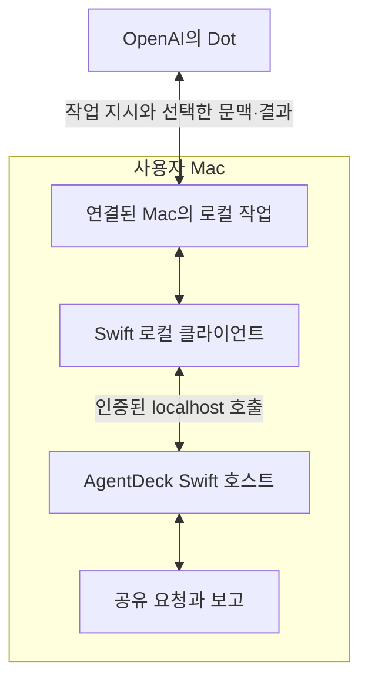

# Dot과 AgentDeck: 로컬 연결로 공유한 작업 확인하기

기준일: **2026-10-26 KST**. 내부 제품 검토용 설명이에요. **Dot은 아직 일반 AgentDeck 배포물에 포함되지 않아요.** 아래의 실제 검증과 제안 화면을 구분해서 읽어 주세요. 빌드 범위는 [릴리즈 문서](../RELEASING.md#dot-development-and-store-builds), 기술 근거는 [연결·배포 결정문](dot-distribution-decision.md), 출시 조건은 [릴리즈 계획](dot-store-release-plan.md)이 기준이에요.

## 무엇을 하려는 기능인가요

AgentDeck에 **내가 선택해 공유한 요청**을 Dot이 읽고, 그 요청의 진행 상황과 결과를 돌려주는 기능이에요. 목표는 여러 작업 창을 오가며 확인하는 부담을 줄이는 거예요. Mac 대시보드나 책상 위 디바이스의 표시도 이 요청에 대해 받은 보고를 바탕으로 해요.

예를 들어 테스트 실패 로그 중 필요한 부분만 공유하고, Dot에게 원인 후보와 다음 확인 단계를 정리해 달라고 요청할 수 있어요. AgentDeck에서는 이 요청이 아직 보고를 기다리는지, 작업 중인지, 완료 보고가 왔는지 확인하는 흐름을 목표로 해요. **이 예시는 제품 사용 시나리오 제안이며 실제 로그 분석 시험 결과는 아니에요.**

지금 확인한 것은 개발자 중계 서버, 사용자 API 키, 터널 없이 **실제 Dot → 연결된 Mac 작업 → Swift 클라이언트 → 격리된 Swift 호스트**가 요청을 읽고 완료 보고까지 저장할 수 있다는 점이에요. 별도 연결 GUI와 서명 플러그인 설치도 구현·검증했어요. 이후 **플러그인 실행 경로의 설정 오류를 수정하자 로컬 데스크톱 로더에서 도구 4개가 자동으로 발견됐어요.** 다만 같은 패키지를 설치한 Mac에서 Dot이 새로 만든 작업의 첫 턴에도 도구가 보이지 않았어요. 이후 전체 플러그인 목록 조회를 막던 별도의 등록 경로 오류도 복구했으며, 복구 후 다시 만든 Dot 작업에서도 도구는 보이지 않았어요. 일반 사용자 설치부터 첫 요청까지의 경로는 아직 통과하지 못했어요.

## 실제로 확인한 범위

| 항목 | 2026-10-26에 확인한 결과 | 별도로 남은 검증 |
|---|---|---|
| 실제 Dot 요청 처리 | 같은 합성 요청의 읽기·문맥 읽기·수락·진행 보고·완료 보고·최종 조회, 6회 모두 성공. 문맥의 세 수 26·84·12와 합 122 일치 | 일반 사용자가 설치한 플러그인의 자동 도구 인식 |
| 플러그인 자동 로드 | 잘못된 실행 경로를 수정한 0.1.1을 설치하면 로컬 데스크톱 로더에서 네이티브 도구 4개를 자동 발견. 자동 로드된 도구 호출도 미승인 접근을 정상 거절 | 기존 작업과 Dot이 새로 만든 작업의 첫 턴 모두 네이티브 도구 없음. 지원되는 Dot 전달 경로와 공개 설치를 확보해야 함 |
| 네이티브 로컬 실행 | 원본 Swift 호스트 코드가 별도 개발용 앱의 샌드박스와 전용 Keychain에서 실행 | 실제 AgentDeck 제품 앱과 Store 서명·패키징 |
| 동의 | 거절하면 권한이 생기지 않음. 비교 코드를 확인해 승인한 뒤 접근 성공 | 제품의 설치·동의 화면과 독립 사용자 시험 |
| 재시작과 갱신 | 앱을 종료하고 다시 열어 연결과 완료 요청 복원. 최초 승인 419.8초 뒤 조회 성공 | 잠금·잠자기·네트워크 손실·계정 변경 등 전체 복구 시험 |
| 연결 철회 | 철회 후 기존 클라이언트 접근 거절. 임시 권한·Keychain 항목·합성 요청 정리 | 제품 UI의 철회 안내와 사용자 이해도 |

갱신 조회는 최초 접근 토큰의 최대 수명 300초 이후였어요. 앞선 Dot 호출 중 미리 갱신됐을 수 있어 정확한 갱신 시각은 측정하지 않았어요. 실제 Dot 작업이 클라이언트를 **명령으로 명시 실행한 시험**이며, 일반 사용자가 터미널을 쓸 필요가 없는 설치 경험을 입증한 것은 아니에요. [측정 기록](dot-distribution-decision.md#local-executor-checkpoint-2026-10-25)

## 이번에 마무리한 구현과 시험

별도 SwiftUI 연결 창에서 버튼을 누르고 AgentDeck의 비교 코드를 확인해 승인하면, 연결 정보가 Mac 키체인에 저장돼요. API 키나 터널을 입력하는 칸은 없어요. 실제 설치된 실행 파일의 stdio MCP를 기존 Dot 위임 작업이 명시적으로 실행하여 **25 + 98 + 35 = 158**을 보고했고, 호스트도 진행·완료를 확인했어요. 연결 창에서 철회한 뒤에는 접근이 거절됐고, 임시 연결·요청·시험용 설치를 정리했어요.

이 시험은 준비된 개발 환경에서 진행했어요. 후속 조사에서 당시 패키지의 실행 명령 `${PLUGIN_ROOT}/bin/agentdeck-local`이 실제 플러그인 로더에서 거부된 사실을 찾았어요. `./bin/agentdeck-local`로 고친 0.1.1은 로컬에서 자동 로드돼요. 따라서 당시의 도구 미노출만으로 플랫폼 미지원을 판단할 수 없어요.

수정 후에도 **기존 Dot 위임 작업**의 후속 턴에는 도구가 없었어요. 플러그인을 명시적으로 지정해도 같았고, 그 Mac의 설치·활성화 상태는 정상이었어요. 당시에는 Dot 작업에서 로컬 도구가 보이지 않았고 새 작업의 첫 턴에서도 같은 결과였어요. 아래의 추가 등록 오류가 나중에 발견됐으므로 원인을 플랫폼으로 확정하지 않아요. 모든 계정이나 배포 조건에서 지원되지 않는다는 뜻은 아니에요. [설치·왕복 및 후속 로더 기록](dot-distribution-decision.md#installed-native-package-checkpoint-2026-10-26)

사용자가 메인 Dot에 새 작업 생성을 명시적으로 요청해 **“Check native AgentDeck visibility”** 작업을 만들었어요. 이 새 작업의 첫 턴에서도 네이티브 도구 4개가 보이지 않았어요. 따라서 기존 작업을 재사용해서 생긴 문제만으로는 설명할 수 없어요. 같은 시점의 로컬 로더 대조 검사에서는 설치된 0.1.1의 도구 4개가 정상으로 나왔어요. 이 결과는 아래 등록 경로 복구 전의 관측이에요. 복구 후의 새 작업에서도 같은 결과였지만, 실제 Dot 실행 프로세스의 설정·앱 전체 캐시·계정 정책 중 원인은 아직 구분하지 못했어요. 연결 승인 없이도 로컬 도구 목록은 보였으므로 권한 재승인을 해결책으로 안내하지 않아요.

추가로 기존 HTTP 프리뷰 플러그인의 마켓플레이스가 삭제된 작업 폴더를 가리켜 **전체 플러그인 목록 조회가 실패**하는 설정 오류를 찾았어요. 기존 설치 파일의 동일 사본으로 등록 경로를 복구해 전체 조회를 정상화했어요. 기존 연결·인증 정보·서버 주소는 변경하지 않았어요. 앞선 로컬 진단기는 특정 마켓플레이스만 조회해 이 오류를 놓쳤으므로, 이제 전체 등록 상태도 검사하도록 고쳤어요. 복구 후 새 **“Inspect native fixture tools”** 작업의 첫 턴에서도 네이티브 도구 4개는 보이지 않았어요. 같은 시점의 전역 등록·로컬 로더 검사는 0.964초 만에 통과했어요. 두 설정 오류를 고친 것만으로 현재 Dot 경로의 자동 노출이 회복되지는 않았다는 뜻이에요. 모든 Dot 환경의 미지원이나 특정 계정 정책의 차단을 확정한 것은 아니에요. 추가 승인이나 실제 도구 호출 없이 관측했고, 시험 후 임시 플러그인 설치를 정리했어요.

첫 설정 진입점인 **Run setup** 스킬도 패키지에 추가했어요. 설치된 패키지의 연결 앱을 열고 사용자가 코드·권한을 직접 승인하는 흐름이에요. 실제 설치된 0.1.1의 연결 창과 호스트가 꺼져 있을 때의 실패 안내까지 확인했어요. 공개 디렉터리의 Run setup 버튼부터 첫 요청까지 이어지는 일반 사용자 시험은 남아 있어요.

추가로 설치본 GUI에서 승인한 연결을 **자동 로드된 MCP 도구**로 읽고, 합성 계산 `50 + 41 + 88 = 179`의 진행·완료를 저장했어요. 호스트가 두 보고를 확인했고, GUI에서 철회한 뒤에는 접근이 거절됐어요. 임시 권한과 요청은 모두 정리했어요. 이 시험은 모델을 실행하지 않은 로컬 API 검증이며, 실제 Dot 작업의 성공으로 셈하지 않아요.

## 정보는 어디로 가나요

이 경로에는 **AgentDeck 개발자가 운영하는 중계 서버가 없어요.** 다만 Dot은 클라우드에 있고, 선택해 공유한 문맥과 결과는 OpenAI가 처리해요. “로컬 연결”이 인터넷을 사용하지 않거나 모든 데이터가 Mac 밖으로 나가지 않는다는 뜻은 아니에요.

목표 배포에서는 네이티브 클라이언트를 ChatGPT의 지원되는 로컬 플러그인에 넣고, AgentDeck 앱은 자체 Swift 호스트를 실행해요. 기존 HTTP 프리뷰와 별도로 네이티브 패키지를 만들고 시험용 로컬 설치까지 확인했어요. 공개 디렉터리 배포나 Dot의 자동 도구 인식이 완료된 상태는 아니에요. AgentDeck 앱이 별도 실행 파일을 실행하거나 사용자에게 언어 런타임 설치를 요구하는 방식은 제품 범위에 넣지 않아요.

## 제안하는 첫 사용 흐름

**아래는 미출시 제품 흐름 제안이에요.** 현재 가능한 설치 안내로 사용하면 안 돼요. 화면은 설치 자체보다 사용자가 공유 범위와 결과를 이해하는 데 집중해야 해요.

| 순서 | 사용자가 하는 일 | 화면에서 확인할 내용 |
|---|---|---|
| 1. 사용할 환경 준비 | 지원되는 AgentDeck·ChatGPT 앱과 플러그인을 준비해요 | 이용 가능한 계정·앱 버전, Mac 연결 상태. 준비가 안 됐으면 필요한 조치 하나를 안내 |
| 2. Mac 접근 허용 | Dot 프로필에서 이 Mac 접근을 허용해요 | 이 권한은 AgentDeck 연결과 별개이며 ChatGPT에서 관리한다는 설명 |
| 3. AgentDeck 연결 동의 | 플러그인의 Run setup으로 연결 창을 열고 요청 읽기·보고 권한을 확인해요 | 요청한 클라이언트, 비교 코드, 승인·거절. 거절해도 AgentDeck의 다른 기능은 계속 사용 |
| 4. 공유할 요청 확인 | 로그 일부나 질문을 미리 보고 필요한 부분만 공유해요 | 실제 전송할 문맥과 OpenAI 처리 안내. 연결 승인만으로 모든 기록을 공유하지 않음 |
| 5. Dot에게 요청 | Dot에게 이 요청을 처리해 달라고 말해요 | 요청 식별 정보와 현재 보고 상태. 연결됐다는 이유만으로 작업 중 표시를 만들지 않음 |
| 6. 결과 확인 | 완료 보고와 근거를 확인해요 | 요청 제목, 결과 요약, 보고 시각. 첫 실제 왕복이 끝나야 기능 검증 완료로 표시 |

설치 과정의 목표는 **터미널·사용자 API 키·터널 설정 없이 진행하는 것**이에요. 연결 상태를 정상으로 표시하는 단계와 첫 요청 처리가 검증된 단계는 구분해야 해요. 이를 한 번의 초록색 “연결됨”으로 합치면 실패 지점을 찾기 어려워져요.

## 작업 표시를 어떻게 읽나요

AgentDeck이 아는 것은 **공유 요청에 대해 받은 보고**예요. Dot의 모든 클라우드 활동을 실시간으로 관찰하는 기능은 아니에요.

| 표시 | 의미와 다음 행동 |
|---|---|
| 연결 준비됨 · 보고 없음 | 도구 연결은 준비됐지만 이 요청의 작업 보고는 아직 없어요. Dot에게 요청했는지 확인해요 |
| 이 요청 작업 중 | 최신 진행 보고가 왔어요. 요청 제목과 마지막 보고 시각을 함께 보여줘요 |
| 완료 보고 도착 | 이 요청의 완료 보고와 결과를 받았어요. 외부 작업까지 독립 검증했다는 뜻은 아니에요 |
| 상태 확인 필요 | 보고가 오래됐거나 현재 접근을 확인할 수 없어요. 마지막 보고를 과거 기록으로 남기고 계속 작업 중인 것처럼 움직이지 않아요 |
| 연결 권한 만료 | 이 연결의 사용 권한을 다시 확인해야 해요. 과거 완료 기록을 진행 중으로 되돌리지 않아요 |

큰 화면과 작은 디바이스는 표현 방식이 달라도 같은 의미를 전달해야 해요. 색만으로 구분하지 않고 문구·형태를 함께 사용해요. 물리 디바이스별 실제 Dot 반응은 별도 검증 대상이에요. [표면별 표현 규칙](dot-creature-surfaces.md)

## 앱 종료·끊김·철회

Dot의 클라우드 작업은 Mac이 꺼져도 계속될 수 있어요. 반면 이 Mac의 로컬 경로는 컴퓨터가 온라인이고 ChatGPT 앱이 실행 중이어야 해요. Dot의 Mac 접근 권한과 현재 온라인 여부는 서로 달라요. [OpenAI의 컴퓨터 연결 설명](https://learn.chatgpt.com/docs/dots/computers-and-apps)

| 상황 | 사용자에게 설명할 내용 | 검증 상태 |
|---|---|---|
| 창만 닫음 | 창 유무만으로 연결이나 작업 중단을 판단하지 않아요 | 제품 앱에서 실제 동작 확인 필요 |
| Mac 오프라인 또는 ChatGPT 앱 종료 | 로컬 경로를 사용할 수 없어요. Dot의 클라우드 작업 종료로 표시하지 않아요 | 공식 전제는 확인, 전체 제품 복구 시험은 남음 |
| AgentDeck 호스트 재시작 | 저장된 권한과 보고를 복원하고 새 호출로 연결을 확인해요 | 격리 개발용 앱에서 확인 |
| 보고가 오래됨 | 마지막 보고 시각과 상태 확인 필요를 보여줘요. 자동으로 완료라고 바꾸지 않아요 | DotPreview UI에 구현, 실제 배포 제품 수용 시험 필요 |
| AgentDeck 연결 철회 | 해당 연결의 이후 요청 읽기와 보고 접근을 막아요 | 격리 개발용 앱에서 접근 거절 확인 |

**AgentDeck 연결을 철회해도 Dot의 Mac 접근 권한까지 철회되는 것은 아니에요.** Mac 접근은 ChatGPT의 Dot 프로필에서 별도로 관리해요. 이미 OpenAI에 전달한 문맥이나 대화가 AgentDeck 연결 철회로 삭제되는 것도 아니에요. 해당 데이터의 관리는 ChatGPT의 별도 설정을 따라야 해요. 이번 시험에서 임시 요청이 로컬 호스트에서 정리된 사실과 외부 서비스의 데이터 삭제는 구분해요.

철회 버튼은 작업 취소 버튼과도 달라요. 접근을 막았다는 이유만으로 이미 시작한 Dot 작업이 취소됐다고 표시하지 않아요.

## 누구나 설치할 수 있게 하려면

공식 문서는 stdio MCP와 의존 파일을 묶는 **승인 파트너용 데스크톱 플러그인 경로**를 설명해요. 제출 조직의 허용 목록 등록을 확인하고 심사를 거쳐야 해요. 데스크톱 전용 플러그인은 ChatGPT 데스크톱 앱에서 설치하며 로컬 실행 스레드에서 사용할 수 있어요. 이것이 임의의 Dot 작업에 도구가 자동 전달된다는 보장은 아니에요. [OpenAI의 데스크톱 전용 제출 안내](https://developers.openai.com/plugins/deploy/desktop-only)

| 남은 조건 | 통과 기준 |
|---|---|
| 지원되는 배포와 도구 인식 | 해당 조직의 제출 자격 확인, 실제 설치한 플러그인을 Dot의 지원되는 로컬 작업에서 사용 |
| 일반 사용자 설치 | 독립 계정 두 개와 깨끗한 Mac 프로필에서 개발자 자격 증명 없이 GUI 설치·동의·첫 요청·철회 성공 |
| 일상적인 복구 | 잠금·잠자기·앱 종료·네트워크·만료·동시 요청 시험에서 허위 완료와 무한 작업 중 표시가 없음 |
| 실제 제품과 디바이스 | 제품 앱의 소유권·저장·표시 및 출시할 물리 디바이스에서 같은 보고 확인 |
| Store와 공개 배포 | 정확한 서명 후보의 전체 검증, archive 검사, 공증, 새 설치, 심사 및 공개 상태 확인. 현재 연결 앱은 Gatekeeper에서 `Unnotarized Developer ID`로 거부됨 |

현재 판단은 **로컬 방식의 기술적 가능성은 확인했고, 일반 공개 릴리즈는 보류**예요. 소개 자료에는 실제로 구현한 연결 창과 아직 검증되지 않은 전체 설치 흐름을 구분해 표시해요.

## 이전 실험은 어떻게 보나요

2026-10-10~11에는 공식 터널과 Node 어댑터로 실제 Dot 요청 처리 및 Mac 크리처 상태 변화를 확인했어요. 이후 Node 로컬 실행에서는 합계 163, 2026-10-26의 네이티브 로컬 시험에서는 합계 122를 확인했어요. 각 경로의 증거를 합쳐 하나의 제품 설치 시험처럼 설명하지 않아요. [날짜별 기록](dot-distribution-decision.md#real-account-validation)

공식 터널은 비공개 상호운용 실험으로 남겨 두며, 일반 사용자에게 터널 키 관리를 요구하는 설치 경로로 삼지 않아요. 개발자 서버 운영을 줄이려는 제품 방향도 그대로예요.

MCP Events 자동 실행, 하드웨어 버튼으로 Dot 깨우기, 전역 Dot 활동 관찰, 캐릭터 자동 가져오기는 이번 로컬 왕복 시험에서 입증한 기능이 아니에요. 첫 공개 범위는 사용자가 명시적으로 공유하고 요청한 작업의 읽기·보고부터 검토해요.

## 관련 자료

- [기술 결정과 측정 근거](dot-distribution-decision.md)
- [릴리즈 조건과 공식 지원 문의 초안](dot-store-release-plan.md)
- [네이티브 클라이언트 검증](../integrations/chatgpt-local/native/README.md)
- [사용 시나리오 검토 기록](../experiments/dot-local-journey/REVIEW.md)
- [Dot 크리처·상호작용·표면별 표현](dot-creature-surfaces.md)
