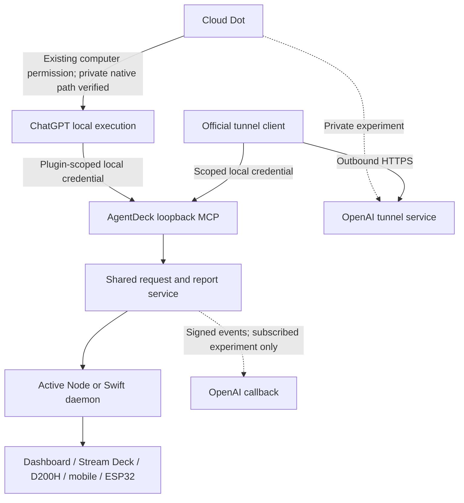

# Dot connection and distribution decision

Reader overview: [Dot 연결과 배포를 쉽게 설명한 한국어 안내](dot-connection-explained.ko.md), with diagrams of the current private experiment, request lifecycle and public-distribution gates.

Initial decision: 2026-10-09; latest local-route update: **2026-10-26**. The [release plan](dot-store-release-plan.md) records the preferred local route and remaining gates. This document preserves the transport rationale and dated evidence. It supersedes public-domain/certificate onboarding in [the earlier MCP Events plan](dot-mcp-events-plan.md), retaining its request/report contracts and [surface semantics](dot-creature-surfaces.md). Actual Dot request/report is proven through the private tunnel, a Node client on the connected Mac, and now a native client against the isolated signed Swift host. Automatic native-tool discovery in the local Codex app-server is proven. Two configuration defects have been repaired: an invalid native command and a stale marketplace source that broke global plugin enumeration. A newly created Dot task still lacked all four native tools after both repairs, while the same-time local control passed global enumeration and exact plugin discovery. The tested Dot path remains blocked. The actual desktop app also loaded the fixture successfully; later code inspection identified a separate Dot executor registration cache, whose live roots have not been observed. After the user completed the standard plugin UI Disable/Enable, two existing-task follow-ups still lacked the native tools but exposed both fixture skills at the exact installed 0.1.1 root. This narrows the unresolved boundary to plugin skills versus MCP tool delivery; complete package omission or stale root registration alone cannot explain both observations. A legacy-format 0.1.2 fixture discovers four tools locally only with a machine-specific absolute command. After the user confirmed its UI toggle, Dot reported neither fixture tools nor skills; no 0.1.2 root was observed despite successful local installation, skill discovery and actual desktop startup. The registration/capability-delivery boundary remains unresolved, and automatic Dot release is NO-GO. This does not establish legacy-format incompatibility or universal Dot non-support. Production-app acceptance and general public distribution are not established. The current Apple build boundary is below.

## Current build boundary — 2026-10-12

Dot is now restricted to explicit Apple DotPreview development configurations. Standard
macOS/iOS builds exclude the whole feature; the [release contract](../RELEASING.md#dot-development-and-store-builds)
is canonical. The earlier server-free choice below remains dated research evidence.
Future Cloudflare work can use the same development boundary; no cloud service is
implemented or deployed by this separation.

## Installed native package checkpoint — 2026-10-26

A separate Developer ID-signed arm64 plugin package now includes the native stdio
client and a real SwiftUI connection/revocation app. Package regression tests,
portable manifest schemas, archive extraction, signatures and four canonical tool
schemas passed. The official CLI installed the fixture package locally. The GUI
completed code-matched consent without a user API key, tunnel or terminal input.

A follow-up in the **existing Dot-created connected-Mac worker** explicitly invoked
the installed stdio executable and completed all six request calls. It obtained
**25, 98, 35** from shared context and reported **158**; the host independently
observed working and completed. GUI revocation removed the grant and Keychain
entry, subsequent access was rejected, and temporary installation and host state
were cleaned up. This is an installed transport and GUI trial in a prepared
fixture, not a new main-Dot delegation or a clean-user product installation.

The initial installed version **0.1.0** used
`"command": "${PLUGIN_ROOT}/bin/agentdeck-local"`. The desktop's bundled Codex
**0.164.0-alpha.11.1** app-server rejected it during `mcpServerStatus/list`:
``Agent Plugins stdio command must be a bare executable name or a contained `./` path``.
That package could execute explicitly but could not load as a plugin MCP server.
Its missing-tool results were therefore confounded by invalid configuration; they
cannot establish a Dot platform limitation.

Version **0.1.1** changes the command to `./bin/agentdeck-local`. The subsequent
initial controls distinguish the package loader from the actual Dot worker. The later [fresh-worker checkpoint](#fresh-dot-created-worker-checkpoint-2026-10-26) adds a newly created task:

| Check after the correction | Observed result | What it establishes |
|---|---|---|
| Bundled Codex 0.164.0-alpha.11.1 app-server | Correct native plugin identity and all four tools discovered automatically in 2.4248 seconds | The installed package loads through the local MCP plugin loader |
| Independent PATH Codex 0.160.1 app-server | The same four tools discovered in 2.9383 seconds | The earlier negative result is not explained by this CLI version difference |
| Bundled app-server's public API, ephemeral thread | Automatically loaded native `get_request` returned expected `-32001 Local authorization required` in 0.3011 seconds, with no grant and the fixture host stopped | Local tool dispatch reaches the native authorization boundary; this model-free probe is not a Dot request round trip |
| Existing Dot-created worker, new turn | Version 0.1.1 was installed/enabled locally, but its inventory still contained zero native tools and nine existing cloud tools | Automatic exposure remains unproven in this cloud-coordinated worker |
| Same worker, another new turn with the documented plugin mention | Again zero native tools and nine cloud tools; no fallback calls | Mentioning the plugin did not resolve this worker's inventory; a newly created worker had not yet been tested at this stage |

The two corrected-package Dot turns were
`01a1753f-b9ca-7386-b350-7b9287886f58` and
`01a17541-6b0a-7528-95bf-c6a0064f609f`. **Local loader success, Dot tool exposure and
ordinary Directory installation are separate acceptance results.** The remaining
inventory gap is observed, but its platform cause is not established. Do not label
all Dot/local MCP paths unsupported.

A further **user-initiated request to the main Dot** produced turn
`01a17558-992c-711b-b1f5-a3dcfc3e9000`. The recorded Dot delegation explicitly
selected the same existing connected-Mac diagnostic worker and prohibited creating
another task. It again observed **zero native tools and nine cloud tools**, using
metadata only, without AgentDeck calls, CLI execution or consent. The publisher's
0.1.1 package remained installed and enabled. This reproduces the inventory gap
through actual main-Dot delegation, beyond the earlier diagnostic follow-ups.
That turn did **not** test a newly created worker: the main Dot reused the old one.
At that stage, cached task configuration, execution-environment routing and
platform plugin policy remained possible causes. Local discovery succeeded without a grant, so repeating
AgentDeck consent is not an evidenced remedy for the missing tool metadata.

A subsequent installed-0.1.1 GUI check launched the actual Connect app and showed
an appropriate connection error while the fixture host was off. Gatekeeper's
`spctl --assess --type execute` check of that app returned **exit 3**,
`source=Unnotarized Developer ID`. The prepared-machine launch therefore does not
prove consumer installability: notarization is now an observed assessment failure,
not merely an untested release step.

After the approved isolated Swift fixture was started, the installed GUI completed
code-matched `read/report` consent. An ephemeral thread using the app-server's public
API then dispatched **six calls through the automatically loaded native MCP**:
`get_request` → `get_context` → `claim_request` → working sequence 1 → completed
sequence 2 → final `get_request`. The shared values **50 + 41 + 88 = 179** and marker
`native-dot-00479759-c8e4-4733-a554-02eef2021426` matched request
`req_387BE102-06DE-4125-AF2A-9F3B7C6D1DD3`. The host receipt independently recorded
working at **2026-10-25 22:55:14 UTC** and completed at **22:55:28 UTC**. GUI revocation
made the next MCP read return `-32001 Local authorization required` in **0.246 seconds**.
The fixture ended with zero grants and requests, its host stopped and app quit.

This was a **model-free local API validation**, not a Dot-worker success. It proves
the installed GUI, authenticated local plugin dispatch and revocation in this
prepared fixture. It does not prove Directory Run setup, installation by an
ordinary user, or automatic tool exposure in Dot.

The new 0.1.1 `onboardingSkill` has passed manifest and skill validation only; its
real Run setup installation/consent journey still requires acceptance. Partner
eligibility and submitting-organization allowlisting remain unverified. Local
marketplace installation cannot satisfy that public-distribution gate. No public
submission occurred.

The source also improves DotPreview settings: local host setup/start, copied
request references, approved-connection wording, stale-report guidance and explicit
revocation limits. Standard Store builds still exclude Dot. The detailed
[client/package evidence](../integrations/chatgpt-local/native/README.md#gui-and-package-acceptance-2026-10-26-kst)
is the current checkpoint; the earlier experiments below remain dated evidence.

## Fresh Dot-created worker checkpoint — 2026-10-26

The user next explicitly asked the main Dot to create a new local Codex task on
the connected Mac, without reusing the existing diagnostic worker. Dot created
**Check native AgentDeck visibility**, task
`01a1755e-6f81-737f-b626-73effe9e600c`, on host `durable`, with a new dated Mac
working directory. Its first and only turn,
`01a1755e-79aa-7161-a4ed-398ee2b64d37`, completed in **8.486 seconds**. The recorded
initial delegation identifies source Dot thread
`01a172aa-7c50-742c-b634-cfdd39cfc0d8` and preserves the user's restriction to tool
metadata: no CLI/HTTP fallback, connection approval or actual AgentDeck call.

The new worker reported that none of the native fixture's `get_request`,
`get_context`, `claim_request` and `report_update` tools appeared. It made **zero
tool calls**. Its cloud-tool count was not reported; do not copy the earlier
worker's count of nine into this new task's evidence.

The same Mac still had `agentdeck-native-fixture-preview` **0.1.1** installed and
enabled. A fresh independent local app-server control again passed exact plugin
identity and all four canonical input schemas in **2.928 seconds**, using bundled
Codex **0.164.0-alpha.11.1**. The installed plugin manifest SHA-256 was
`ba93334fc006d6ed94b70575630fb850115b3ea60b502be8c4b251445b300fb4`.
The token-free task-local evidence is `dot-native-exposure/fresh-worker-local-control.json`;
this control performs discovery only and does not authorize or call AgentDeck tools.

**Before the marketplace recovery below, the newly created Dot task lacked
native tools while the selected-marketplace local control passed.** Configuration
retained only by the old worker cannot explain this result. However, the later
global-registry failure is a separate configuration confound: the passing control
used a marketplace filter and did not prove the health of every registered source.
The fresh-worker result therefore does not isolate platform routing or policy as
the cause. At this checkpoint, Dot exposure after registry recovery had not yet
been observed; the [post-recovery test](#post-recovery-dot-worker-checkpoint-2026-10-26) below records the later comparison.

G0 remains blocked. Preserve the pre-recovery comparison and its newly found
confound together in the
[prepared support inquiry](dot-store-release-plan.md#questions-for-openai-prepared-not-sent).
Neither the local positive control nor registry recovery establishes Dot success;
no inquiry or public submission has been sent.

## Marketplace registry recovery — 2026-10-26

A later unfiltered `codex plugin list --json` failed because the existing
`agentdeck-local-preview` marketplace still pointed to the deleted
`dot-distribution-decision/AgentDeck/diagnostics/dot-local-marketplace` worktree
source. The earlier runtime diagnostic used `--marketplace` for the native
fixture, bypassing that broken source. Its local tool-discovery result remains
valid, but it was not a global plugin-registry health check.

The recovery rebuilt a marketplace source from the original installed cache's
same **five payload files** plus a marketplace manifest, under the task-local
`dot-native-exposure/recovered-original-marketplace` artifact. Official CLI
marketplace remove/add commands re-registered the source. The recovery receipt,
`dot-native-exposure/marketplace-recovery-result.json`, records successful global
plugin enumeration, the original plugin still installed and enabled, unchanged
installed-payload hashes, and no authentication or endpoint change. This repaired
source registration; it did not grant access or alter the original MCP payload.

The same receipt records the native fixture as **not installed** at that snapshot.
After recovery, the 0.1.1 fixture was reinstalled through the official CLI.
The strengthened runtime diagnostic required the unfiltered global inventory to
succeed before selecting the exact plugin. It passed in **1.165 seconds** with
the desktop-bundled CLI `0.164.0-alpha.11.1`, discovering all four canonical input
schemas (`dot-native-exposure/post-recovery-runtime.json`). No grant or AgentDeck
tool call was made. At this point the fixture was installed without authorization
for the requested post-recovery Dot metadata check.

The earlier fresh Dot worker's missing-tool result preceded this recovery and
cannot be treated as a post-recovery observation. The following separate test
records the recovered registry and reinstalled fixture together.

## Post-recovery Dot worker checkpoint — 2026-10-26

After both configuration repairs, the user again asked the main Dot to create a
new task on the connected Mac. Codex `list_threads` and `read_thread` results
independently identified **Inspect native fixture tools**, task
`01a1757c-edba-7402-b3e4-fe29c7ce9022`, created at Unix time **1792972485**. Its
recorded host was `durable`, with a new dated Mac working directory. Its first
and only turn, `01a1757c-f794-763f-9959-55921921ee8d`, ran from Unix time
**1792972487** to **1792972503**, with a recorded duration of **16.159 seconds**.
The delegation identifies source Dot thread
`01a172aa-7c50-742c-b634-cfdd39cfc0d8`. These task records independently establish the
new task identity even though the worker itself could not see its task ID.

The worker reported that all four native tools (`get_request`, `get_context`,
`claim_request`, `report_update`) were absent from its first-turn metadata. It
made no tool calls, file accesses, CLI/HTTP fallback, consent or other actions.
The cloud-tool count was not measured. A `durable` host label and Mac working
directory do not establish which executor or effective MCP configuration supplied
that turn's tools.

The same-time local control passed unfiltered global plugin enumeration, exact
plugin identity and all four canonical input schemas in **0.964 seconds**, using
bundled Codex **0.164.0-alpha.11.1** and installed plugin **0.1.1**. The manifest
SHA-256 remained
`ba93334fc006d6ed94b70575630fb850115b3ea60b502be8c4b251445b300fb4`.
It performed discovery only, with no authorization or AgentDeck tool calls.
Task-local evidence is retained as
`dot-native-exposure/post-recovery-fresh-dot-worker.json` and
`dot-native-exposure/post-recovery-dot-local-control.json`.

**Fixing the two known configuration defects was insufficient to restore native
tool exposure in this tested Dot path.** Configuration retained only by the old
worker is not a sufficient explanation either. The effective Dot executor
configuration, application-wide cache, execution routing and account/platform
policy remain unverified. This comparison does not establish universal Dot
non-support or an account policy denial. Local discovery without a grant also
means the missing metadata is not evidence that another AgentDeck consent would
resolve it. G0 remains blocked until a supported Dot path passes tool exposure
and the actual request cycle; ordinary-user installation is a separate gate.

After the test, the temporary fixture installation and its staging marketplace
were removed through the official CLI. The original HTTP plugin's recovered
marketplace registration remains; its authentication and endpoint were not changed.
No support inquiry or public submission has been sent.

## Desktop runtime and registration-cache checkpoint — 2026-10-26

The installed ChatGPT desktop app was **26.1021.31345, build 21828**. Its actual
local app-server process (**PID 55259**) logged the native fixture moving from
`starting` to `ready` at **2026-10-25 23:54:13 UTC**. This extends the independent
local controls: the running desktop itself loaded the plugin. It does not show
that the Dot task received its tools. The desktop-bundled CLI and the plugin
app-server binary copy matched version **0.164.0-alpha.11.1** and SHA-256
`a04752e4d46a4d89e53e6f61c59c5349a638c8ce172ffbf391fd482b4d902a4e`.
The default public daemon proxy belonged to a different managed service, version
**0.164.0**; its responses are not the live state of desktop PID 55259. No public
control socket for that desktop app-server was identified.

The inspected local configuration resolved to the same Codex home for this
checkout and the Dot task's working directory. No project override, selected
profile, explicit `plugins`/`apps` feature override or AgentDeck tool-deny filter
was found. Absence of a local override does not establish the effective cloud
policy or feature defaults.

Inspection of this exact desktop build distinguishes the durable host's cloud
WebSocket connection from the local app-server. Its `tpp-local-executor` starts a
separate `exec-server`. `readCapabilityRoots()` reads the LOCAL host's
`plugin/installed` inventory and Codex home, and includes installed, enabled custom
plugins as versioned cache paths with plugin IDs. The executor registration sends
these as `selected_capability_roots`; later `thread/environmentReady` reports map
them into the selected environment. The inspected `excludeFromExecutor` filter
applies to `openai-bundled` entries, not custom AgentDeck plugins. This code path
supports exporting custom plugin roots; it does not prove that the failing Dot
turn received the intended roots or accepted their MCP configuration.

The desktop retains those roots in `registeredPluginRoots`. Explicit refresh
calls were found for project-root/order changes, browser plugin configuration,
bundled-plugin reconciliation and bundled skill overlays. No generic watcher for
CLI-installed custom-plugin changes was found in the inspected code. A durable
WebSocket reconnect or power resume reports the cached roots again; it does not
reread the installed-plugin inventory. Full app startup reaches
`startConversationExecutor()` → `startOnce()` → `registerExecutor(undefined)`,
which does reread the roots before registration.

A narrower UI path was then traced in the same build. The standard local-plugin
**Enable/Disable** callback writes the setting with `config/batchWrite`, then calls
`browserPluginConfig.syncAfterPluginChange` for the local host. The main-process
handler invokes `onPluginsChanged`, wired to `refreshConversationExecutorPlugins`.
Thus disabling and re-enabling the fixture in the ordinary plugin UI invokes
registration refresh without requiring a full app restart. This establishes the
source-code path; the subsequent UI comparison below still lacked native tools.
The earlier CLI installation did not exercise that UI callback. Stale registration
was a hypothesis at this stage, not a confirmed defect or completed repair.

The actual `selected_capability_roots` of the tested Dot tasks were not logged or
otherwise observed. No readiness-report failure was correlated with these fresh
tasks; their UI `thread/read` access errors do not establish MCP discovery denial.
The prepared comparison was **Disable → Enable the fixture in the standard
local-plugin UI**, followed by Dot metadata inspection. A full ChatGPT quit/relaunch
has a broader source-supported root-reread boundary; network reconnection or
revoking/regranting one Dot's computer permission is not established as an
equivalent refresh. The user subsequently completed the UI toggle. Its actual
observations below are existing-task follow-ups, not a new task's first turn.

For that comparison, fixture **0.1.1** has been reinstalled without a grant after
the previous test's cleanup. The global-inventory and four-tool preflight passed
in **1.428 seconds**. No credentials were read, private RPCs invoked or hidden
features changed during this investigation. Evidence is retained under
`dot-native-exposure/runtime-environment-investigation/` as `comparison.json`,
`desktop-registration-log-summary.json` and `bundle-registration-excerpt.txt`;
the source excerpt records the installed archive hash and exact source offsets.
The preflight is `dot-native-exposure/cache-reload-preflight.json`.

The [official MCP documentation](https://learn.chatgpt.com/docs/extend/mcp)
describes shared configuration among Codex clients on the same host and states
that cloud/web execution does not read local Codex configuration. It does not
resolve this separate Dot capability-registration path or establish blanket Dot
non-support. G0 remains blocked pending supported native tool exposure and an
end-to-end Dot result.

## Plugin UI refresh checkpoint — 2026-10-26

The user confirmed **Disable → Enable** of the native fixture in SBStudio's plugin
UI. The local configuration modification time changed and the fixture ended
`enabled: true`. Two approved metadata-only follow-ups then ran in the existing
**Check fresh native tools** task, `01a17591-50f2-7716-86d6-2e60e7fd90e6`, on host
`durable`: turns `01a17597-1059-7018-8cde-d97cc3da5f4d` and
`01a17598-6646-743c-b91a-e486388f9d90`. The task title does not change the scope:
these were follow-up turns in an existing task, not a fresh task's first turn.

Both observations found **zero native tools**. Nine existing cloud tools were
identified and excluded from the native count. The fixture's **two skills**,
`agentdeck-report` and `setup`, were visible, with this exact reported root:

```text
skill://agentdeck-native-fixture-preview@agentdeck-native-fixture-preview-staging/Users/puritysb/.codex/plugins/cache/agentdeck-native-fixture-preview-staging/agentdeck-native-fixture-preview/0.1.1
```

No skill file or actual AgentDeck tool was called, and no connection approval was
performed. Evidence is retained in
`dot-native-exposure/runtime-environment-investigation/after-ui-toggle-dot-result.json`.
There was no before-toggle skill measurement, so the result does **not** establish
that the toggle made these skills newly appear. The registration payload itself
was not captured; seeing a skill path is not an audit of the entire registered
capability-root array.

The exact installed fixture root reaches this task's skills catalog, while its
native MCP tools remain absent after the UI action. Complete omission of the
fixture package or stale root registration alone is therefore insufficient to
explain both observations. The investigation is narrowed to the boundary between
plugin skill delivery and MCP configuration/tool exposure. This does not exclude
separate MCP caching, configuration-format handling, effective executor settings
or policy, and does not establish a universal platform limitation.

A controlled legacy MCP configuration-format comparison was prepared next.
The following checkpoint records its local result and the version mismatch that
still prevents a valid Dot comparison. G0 remains blocked; skill visibility is
not native-tool availability or an authenticated Dot request cycle.

## Legacy MCP format comparison checkpoint — 2026-10-26

A separate **0.1.2 diagnostic fixture** was installed through the official CLI.
It preserves the plugin ID, local account, port **19476** and native executable;
the executable SHA-256 remains
`1fa5eba49e0bf78a2b0c341cc25ae9f00db509ee386a0ece805b5f07315bf6ac`.
The package uses `.codex-plugin/plugin.json` and `.mcp.json`, with no root modern
`plugin.json` or `mcp.json`, to compare the compatibility-format loading path.
This is a diagnostic package version, not a public release decision.

The relative `./bin/agentdeck-local` command with a plugin-root placeholder `cwd`
returned an `ENOENT` error in public local status. A separate placeholder-command
attempt also failed tool discovery, but its underlying error was not inspected;
`ENOENT` is not established for that attempt. Setting the command to the exact
installed executable's absolute path then allowed an independent public local
app-server to discover all **four canonical schemas in 3.057 seconds**. It made
no AgentDeck tool calls and created no authorization. That absolute command is
**machine-specific diagnostic configuration**, not a portable package or an
ordinary-user deployment solution. It also means this comparison has not yet
established portable launch semantics for the legacy layout.

The next metadata-only follow-up in **Check fresh native tools**, turn
`01a175a4-eb67-74f2-bcfe-3d21a87ee561`, again reported zero native tools and two
fixture skills. However, the reported skill root still ended in **0.1.1**, despite
**0.1.2** being installed locally. No 0.1.2 root was observed. Therefore this is
**not a valid Dot test of the legacy package**: neither compatibility nor
incompatibility of that format can be inferred from the missing tools.

At this stage the user was asked to apply the standard plugin UI Disable/Enable
for the newly installed 0.1.2 fixture. The following checkpoint records the later
observation. Delivery of the 0.1.2 root must still be established before attributing
a Dot tool result to the legacy format. The earlier 0.1.1 UI-toggle result remains
a separate measured checkpoint. G0 remains blocked.

Evidence under `dot-native-exposure/runtime-environment-investigation/` includes
`legacy-ab-package.json`, `legacy-ab-relative-command-runtime.json`,
`legacy-ab-placeholder-command-runtime.json`, `legacy-ab-local-runtime.json` and
`legacy-ab-dot-before-ui-refresh.json`.

## Post-legacy UI verification — 2026-10-26

At approximately **19:03 KST**, the user confirmed completing the 0.1.2 fixture's
UI Disable/Enable. Metadata-only turn `01a177aa-892d-77c5-b33f-8a72de09e089` in
the same **Check fresh native tools** task
(`01a17591-50f2-7716-86d6-2e60e7fd90e6`, host `durable`) then found **zero native
tools and zero fixture skills**. Nine unrelated cloud tools were excluded. Neither
the former 0.1.1 skill root nor a 0.1.2 root was visible; the original
`agentdeck-local` HTTP plugin's skill is a separate package. This remains an
existing-task follow-up, not a new task's first turn or an actual AgentDeck call.

The local evidence points to a different boundary:

- The actual desktop app-server, **PID 55259**, launched fixture **0.1.2** child
  processes observed from **19:02:43 KST**. The inspected startup-log window
  contained **eight `ready` events and zero failed events**; these are event
  counts, not eight distinct processes or proof of Dot inheritance.
- Public local `plugin/installed` returned `installed: true`, `enabled: true` and
  `localVersion: "0.1.2"`; `skills/list` returned both valid fixture skills, with
  zero marketplace or fixture-skill errors. A separate query including the **14
  local project paths** returned by `list_projects` had the same result. These
  public local controls do not capture the live executor's complete root list;
  it may include other saved roots.
- The inspected root-selection code prefers `localVersion` and does not apply
  the built-in exclusion filter to custom plugins. Its separate `version: null`
  field therefore does not explain omission under that code path.
- The **19:01–19:10 KST** log review found no readiness error correlated with this
  task or turn. Global readiness warnings belonged to other placements and do
  not explain this result. Missing matching errors also do not prove successful
  plugin registration.

The configuration modification time was unchanged in this check. That does not
establish that the user's toggle failed, and no repeat of the same toggle is
being requested. The desktop's successful local load and the public skill
inventory do not show which capability roots or plugin configuration reached Dot.

**Automatic Dot release remains NO-GO.** The unresolved boundary is the platform's
registration and delivery of this local plugin's capabilities to the tested Dot
task. Actual 0.1.2 root delivery remains unobserved, so the legacy-format comparison
cannot establish either Dot support or rejection of that format. The evidence
also does not establish that every Dot route is unsupported. Further work needs
version-correlated executor-registration evidence or authoritative platform
guidance; ordinary-user installation and the authenticated Dot cycle remain
separate unmet acceptance gates.

Evidence under `dot-native-exposure/runtime-environment-investigation/` is
`legacy-ab-dot-after-ui-refresh.json`, `post-legacy-toggle-host-summary.json`,
`post-legacy-toggle-registration-errors.json`,
`legacy-ab-local-installed-and-skills.json` and
`legacy-ab-project-roots-installed-and-skills.json`. The updated support inquiry
is prepared only; no message or public submission has been sent.

## Local executor checkpoint — 2026-10-25

The preferred development route is Dot's connected computer and a native client
packaged with an explicitly declared local MCP plugin. AgentDeck continues to own
its authenticated loopback host and request/report state. No publisher-operated
relay is required in this route, and ordinary onboarding should require no API key
or tunnel configuration. OpenAI still processes the task and selected context;
developer-server-free transport does not mean local-only data processing.

| Evidence | Observed result | Limit |
|---|---|---|
| Actual Dot delegation | The existing Dot created work on its connected Mac for an explicitly shared synthetic request | This was Dot-directed local execution, not a manually created Codex task labeled as Dot |
| Local client and provider | The delegated task explicitly invoked a Node client against the localhost provider and completed the correlated request; the synthetic sum was **163** | This path required a prepared client and grant. It does not show automatic local-plugin MCP exposure or ordinary-user onboarding |
| Native client implementation | 16 tests, Release build and actual Developer ID-signed stdio `initialize`/`tools/list` with four tools passed | Private executable validation does not establish plugin installation or actual Dot use |
| Native client against Node host | The validation task approved a new read/report PKCE grant, stored credentials in login Keychain and read `get_request`/`get_context` from separate client processes; refresh and disconnect passed | Read-only request smoke by the validation task, not an actual Dot/native-client round trip or report-write test |
| Isolated Swift host, 2026-10-26 | Organization Apple Development signing and a current-Mac provisioning profile enabled launch, dedicated sandbox-container/Data Protection Keychain checks and the original Swift listener on `127.0.0.1:19476` | The earlier `amfid -413: No matching profile` failure is resolved for this fixture; consumer signing and the production app remain separate |
| Native client consent against Swift, 2026-10-26 | First UI denial returned exit 1 / authorization required and zero host grants; a second code-matched UI approval returned `authorized: true`, saved client credentials in Keychain and created one host grant | This is the development harness UI, not ordinary-user product onboarding |
| Actual Dot with native client and Swift host, 2026-10-26 | Dot's existing local task ran six commands, all exit 0: request, context, claim, working sequence 1, completed sequence 2, final request read. The marker matched and **26 + 84 + 12 = 122** | The validation task made no claim/report writes. Explicit CLI invocation proves the prepared native path, not automatic plugin MCP exposure |
| Swift restart, token lifecycle and cleanup, 2026-10-26 | Quit/relaunch restored the grant and completed request; a read beyond the initial token lifetime succeeded. UI revocation rejected the old client, client disconnect succeeded, later read still failed, and host grants/requests reached zero | Exact refresh timing was not measured. The harness was stopped and quit; full lifecycle, clean-user and product-app acceptance remain separate |
| Public distribution | Official documentation describes approved-partner desktop-only local MCP submission | Publisher eligibility, organization allowlisting, package review and clean-user install/update are not verified |

The earlier 2026-10-09/11 direct-HTTP tests observed no inherited local Codex MCP
tools in those Dot-created tasks. Those observations remain valid for their tested
configuration and execution context; they do not define every supported Dot route.
The later explicit native-client success and corrected installed-plugin controls
above answer different questions. A model-written actor label does not authenticate
Dot identity. Preserve the delegating Dot, actual local executor and authenticated
request grant as separate provenance fields.

The native-client refresh read succeeded **343.7 seconds after initial grant approval**,
after the initial access-token lifetime had elapsed (maximum 300 seconds). Disconnect
used the client's own refresh credential. A later read failed with exit 1 and
authorization required after the Keychain entry was removed. The Node host confirmed
the test grant was absent and its request purged, while both pre-existing grants
remained. This establishes the measured native-client credential lifecycle against
the Node host only; [client evidence](../integrations/chatgpt-local/native/README.md#measured-validation-2026-10-25)
and Swift runtime results must remain separate.

On 2026-10-26 KST (2026-10-25 UTC), the actual Dot reused its existing connected-Mac task and processed
the Swift harness's synthetic request through the native CLI. All six command
results matched the same request. The host audit independently observed working
at **2026-10-25 15:46:07 UTC** and completed at **2026-10-25 15:46:19 UTC**, matching the final marker and
sum 122. The validation task only observed these reports; it did not submit them.

Quitting and relaunching the harness produced a new process and restored the grant
and completed request. A read at **2026-10-25 15:48:43.785 UTC**, **419.8 seconds after initial
grant approval**, returned completed with exit 0. This is beyond the initial access
token's maximum 300-second lifetime and demonstrates continued authorization through
the refresh path. Dot's preceding calls may have refreshed preemptively; the exact
refresh request time was not measured. UI revocation then made the existing client
read exit 1 with authorization required. Client disconnect returned success, a
later read still exited 1, and the host had zero grants and requests. The host was
stopped and the harness quit after evidence was preserved.

The native client belongs in the ChatGPT plugin package, outside the AgentDeck app.
The isolated harness is developer tooling with separate identity and state; it must
not replace the installed app or change its standard build exclusions. Neither
component is a product deployment. A signed harness result will not replace the
signed Release archive, App Store review or fresh-user acceptance gates.

[Desktop-only submission](https://developers.openai.com/plugins/deploy/desktop-only)
allows bundling a stdio MCP server and dependencies, using any supporting language
or runtime. The selected submission structure is root `plugin.json`, root `mcp.json`,
the native executable and the reporting skill. Local MCP still requires confirmed
partner eligibility and organization allowlisting before review, even though the
documented portal upload option is called **Skills only**. Do not use a general
skills-only package to conceal a persistent authenticated transport. Credentials
stay outside the package, prompts and results. The measured Swift consent, restart,
post-expiry access and revocation cycle does not replace the full lifecycle matrix
or installation by independent ordinary users. The original plugin retains its HTTP preview manifest. The separate native
package and later installed-stdio trial are recorded in the newer checkpoint above;
this earlier trial itself did not install a plugin or establish automatic exposure.

## Decision (2026-10-11)

Build toward **AgentDeck's native local MCP + a supported ChatGPT local executor + the user's existing Dot computer connection**. Test desktop Settings → MCP servers → Add server and OAuth before requiring a public local plugin. The documented settings flow is an alternative to directory distribution, but does not itself prove Dot tool availability. Keep AgentDeck on the user's Mac, require explicit local pairing, and reuse ChatGPT's existing account and computer permission. Do not require a second AgentDeck account or Sign in with ChatGPT merely to connect Dot.

This is the selected product direction, not a claim that OpenAI currently offers self-service public distribution of that complete integration. Prove the local route through the documented desktop settings first. Public local-plugin distribution is a separate option; it must not be confused with the supported local-client configuration flow. If neither route establishes actual supported Dot access, keep Dot integration an opt-in private preview; do not advertise a one-click public integration or substitute a hosted service silently.

Use the official Secure MCP Tunnel only for private interoperability experiments and optional operator-managed use. The current request/report adapter does not expose MCP Events. Do not make a tunnel ID, Platform organization, API key, domain or certificate part of ordinary AgentDeck onboarding. No AgentDeck-operated public server is authorized by this decision.

Three requested properties are not jointly established by the current public documentation: (1) no public service operated by AgentDeck or users, (2) install-and-consent onboarding for arbitrary users, and (3) cloud Dot event activation and return calls. Login and plugin packaging alone do not establish the third property's local transport. The release gate must remain visible rather than being hidden by more implementation.

## What the official contracts establish

| Topic | Confirmed evidence | Consequence for AgentDeck |
|---|---|---|
| Dot computer access | Dot can use a connected personal computer, local tasks and supported plugins. One personal computer can be connected; it must be online with ChatGPT open. Local skills require a connected computer. [Computers and apps](https://learn.chatgpt.com/docs/dots/computers-and-apps) | Existing computer access is the first route to test. It does not prove that an arbitrary local MCP server is exposed directly to Dot. |
| Desktop-only plugins | Installable in the desktop app and mentionable only in threads that run locally. A skills-only `requires_local_executor` declaration marks this restriction; it does not create a tool-propagation guarantee. [Desktop-only plugins](https://developers.openai.com/plugins/deploy/desktop-only) | Local marketplace installation, a Dot cloud-coordinated worker and public Directory eligibility must be validated separately. |
| Public MCP distribution | Remote MCP uses the public HTTPS submission path. Local stdio MCP has a separate approved-partner desktop-only route, with package dependencies included and organization allowlisting confirmed before submission. [Desktop-only plugins](https://developers.openai.com/plugins/deploy/desktop-only) | A native plugin client is a documented implementation option; this publisher's eligibility, review outcome and actual Dot tool exposure remain unverified. |
| Skills-only distribution | Skills-only packages have a submission path, but MCP configuration is excluded; credentials or persistent user settings require MCP in the documented migration guidance. [Skills-only submission](https://developers.openai.com/plugins/guides/submit-claude-plugin#submit-a-skills-only-plugin) | A setup/help skill can be published separately. Do not disguise an authenticated local service as a skills-only connection workaround. |
| Commercial ChatGPT sign-in | Identity sign-in uses registered OAuth/OIDC clients; commercial access is a limited partner trial. Connector authorization and user sign-in are separate transactions. [Website sign-in](https://developers.openai.com/siwc/website), [plugin sign-in](https://developers.openai.com/siwc/chatgpt-plugin) | Useful if an AgentDeck account service is later needed, but it neither creates a local route nor grants tool permissions by itself. |
| Open-source ChatGPT plan usage | A local open-source client can dynamically register without a partner API key/client secret and obtain permission for eligible model requests. It does not obtain ChatGPT conversations/account context. [Overview](https://developers.openai.com/siwc/token-sharing-open-source), [registration](https://developers.openai.com/siwc/token-sharing-open-source/sign-in) | This could power a separate AgentDeck AI feature. It does not connect to the user's existing Dot. Eligibility for a paid or remotely hosted product must not be inferred from the OSS flow. |
| Plan-usage limitations | The current direct inference route excludes hosted MCP/connectors and several other hosted tools. [Preview limitations](https://developers.openai.com/siwc/token-sharing-open-source/preview-limitations) | Do not repurpose a plan-usage token as a tunnel-management token or a Dot-control API credential. |
| MCP Events | ChatGPT subscribes to events produced by our server and supplies a signed HTTPS callback contract. The integration supports Work Cloud and dots. [MCP Events](https://developers.openai.com/plugins/build/mcp-events) | Events can wake an authorized workflow; they are not an OpenAI feed of every Dot state change. Tool calls to AgentDeck still require a reachable authenticated MCP path. |
| Cloud Dot hooks and telemetry | Local/plugin command hooks do not run with cloud orchestration. Enterprise remote MCP hooks and cloud audit records have separate scopes; local OTel does not contain all cloud orchestration. [Cloud/local compatibility](https://learn.chatgpt.com/docs/enterprise/cloud-local-access#check-hooks-and-network-compatibility) | No personal-account lifecycle-hook workaround or claim that a local transcript/OTel collector observes all Dot activity. |
| Official tunnel | An outbound client forwards MCP calls to a private server. It needs a tunnel identity, runtime key and permissions/workspace association; it is not a public plugin distribution route. [Secure MCP Tunnel](https://developers.openai.com/api/docs/guides/secure-mcp-tunnels) | Suitable for private interoperability testing. Each installation/organization owns its credentials; a publisher's key is never shipped. |

No documented public API for a personal Dot's global live state, avatar synchronization, or arbitrary remote pause/approval was established in this review. This is a bounded research result, not a claim that no internal or future interface exists. Retain manual character import and the distinction between a reported interaction and target-side acknowledgement.

## Target user experience and capability boundary

The plugin-based public flow, conditional on local-MCP distribution support, is below. The [current release plan](dot-store-release-plan.md#target-architecture-and-user-experience) tests direct desktop registration first and does not require a plugin listing for that route.

1. Install/open AgentDeck and install the AgentDeck plugin in ChatGPT.
2. Grant the existing Dot's access to this Mac in ChatGPT, if not already granted.
3. Approve a local AgentDeck pairing with visible scopes: selected context reads and request/report writes. Subsequent reconnects reuse a revocable grant.
4. Ask Dot to use AgentDeck. Show a successful correlated round trip before declaring the connection ready.

Account login, Dot computer permission, plugin installation and local pairing are separate grants. Reduce repeated setup by persisting valid grants, not by bypassing them. Installation does not silently share transcripts, authorize agent commands, or enroll an event subscription. User-configured subscriptions need their own supported enrollment flow.

| Capability | Local-plugin preview | Private Events experiment | Public launch claim |
|---|---|---|---|
| Explicit Dot request reads selected AgentDeck context and returns a report | Explicit Node-client execution passed on 2026-10-25; actual Dot/native-client execution against the isolated Swift host passed on 2026-10-26. Automatic plugin exposure remains unverified | Real private tunneled request/report passed; Events remain separate | Only after the relevant product, fresh-user and distribution gates |
| Physical key automatically wakes a cloud Dot | Not established by local plugin installation | Candidate through MCP Events | Requires an officially supported subscription and MCP return path |
| Show all unrelated cloud Dot work | Not available from the proposed contracts | Not supplied by MCP Events | Do not claim |
| Show reported delegation/control relations | Reuse bounded report store | Same report store | Label report provenance; verified target observations remain distinct |
| Work after ChatGPT quits | Local computer route becomes unavailable | May work if AgentDeck, tunnel and subscription remain usable; must test | Never infer cloud Dot stopped from local disconnect |
| Work after Mac sleeps or AgentDeck stops | Local tools unavailable | Local tools unavailable | Keep historical reports; no always-online device promise |

The public skills-only fallback is setup/documentation and user-invoked workflows supported by existing tools. It cannot be marketed as the authenticated live connection or event transport. Do not initially publish a skills-only listing under the assumption that MCP can simply be attached later: the [current submission flow](https://developers.openai.com/plugins/deploy/submission) does not support adding an MCP server to an existing skills-only plugin. Keep any such companion's identity and purpose explicit.

## Architecture



The diagram is a product routing design. The 2026-10-26 checkpoint proves Dot delegation and explicit native CLI access to the isolated Swift host; it does not prove installed-plugin exposure or the production daemon/device path. A Codex local-tool success alone does not prove Dot access. Record the delegated execution context instead of claiming a direct cloud Dot MCP invocation.

Keep one domain service for request creation, claims, context, reports, relationships, expiry, revocation and rendering. Transports adapt to it; neither a plugin nor a tunnel owns the source of truth. Reuse the existing schemas and per-surface freshness rules. Do not add a fake session, inflate workload counts, or resurrect a stale WORKING animation during reconnection.

The proposed local adapter binds loopback only and uses an explicit, revocable, plugin-scoped grant. It exposes a route allow-list and bounded payloads, rejects invalid Host/Origin and unsolicited browser access as appropriate, and rate-limits pairing. Loopback location is not authentication. Pair through a user-confirmed one-time transaction; keep credentials outside model prompts/results and plugin archives. Never reuse the hub's LAN pairing token or OpenAI session cookies. Multi-user/workspace identity must be bound by the transport; a model-written actor label cannot establish identity.

The official-client experiment has a separate local credential and restricted personal/workspace context. A fixed header supplied by one operator cannot identify separate users in a shared tunnel. OAuth discovery passing through the tunnel does not make the authorization server automatically reachable; test its browser and token paths independently. Do not promote the private experiment's authentication arrangement to multi-user/public distribution.

Swift implements the local adapter in-process using native networking and Keychain, under the existing daemon ownership/isolation rules. Node exposes the same domain contract. No shell, embedded interpreter, official tunnel binary or external-helper installation prompt is added to the App Store app. These are [repository product constraints](../.claude/rules/apple-release.md), not a prediction of App Review acceptance. A signed sandboxed Release test remains required.

A future in-process Swift tunnel client would require a documented supported protocol/SDK, authorized credential provisioning and native compatibility validation. Porting observed traffic from the official binary is not a selected solution. A future AgentDeck-operated relay would change the no-public-service decision and introduce account, availability, privacy and operating-cost responsibilities; it is outside this plan.

## Implementation and validation order

**Historical stage order:** superseded by [the 2026-10-11 release gates](dot-store-release-plan.md#release-gates-in-order). Prove supported Dot local execution and GUI authentication before broad implementation. A public directory listing is needed only for the plugin route, not necessarily for user-configured desktop MCP.

| Stage | Concrete deliverable | Exit or fallback |
|---|---|---|
| 0. Correct the product contract | This decision, legacy-plan supersession, App Store planned rows, honest setup/display wording | No requirement for public DNS/certificates in the selected product plan; existing implementation remains clearly marked experimental |
| 1. Finish local transport parity | Node and Swift loopback adapter over the existing store; explicit pairing/revocation; plugin capability discovery; separate local/Events capability flags | Positive/negative auth tests, expiry/restart/ownership tests and signed sandbox validation. Generated shared constants, no new per-platform magic values |
| 2. Prove local plugin execution | Private marketplace package with setup/use skills and authenticated MCP configuration; fresh user profile and real Dot tests | Demonstrate which executor invokes which tool, without manual token/file editing. If only local Codex works, label only local Codex support |
| 3. Prove Dot workflows | Ten correlated context/claim/report round trips, including a delegated local task, idle resume, disconnect, stale report, revoked grant and account/workspace mismatch | Record call provenance, required approvals, failures and timings. No completion inferred from receipt or silence |
| 4. Prove optional Events | Official private tunnel, discovery, event list, subscribe/verify, delivery, report, refresh and unsubscribe using a real Dot | Button-to-result test plus duplicate/out-of-order/expiry/offline tests. A mocked callback or HTTP 2xx does not pass |
| 5. Resolve public distribution | OpenAI confirmation of third-party local-MCP packaging, Dot/local support, authentication and supported install/update path; clean-profile install test | If unavailable, remain a private preview. Do not replace it with a public relay or hide manual tunnel credentials behind misleading copy |
| 6. Release the demonstrated scope | Full repository verification, Release archive gate, Node/Swift parity, physical surface acceptance and review/privacy text | Publish only capabilities whose transport, account, lifecycle and installation gates passed |

The real-account lifecycle matrix must cover ChatGPT foreground/background/window-close/full-quit, AgentDeck stopped/restarted, Mac sleep/wake, computer permission revoked, plugin disabled/uninstalled and the selected connection revoked. Keep each signal separate. A local task already running may behave differently from a newly requested task; test both. Do not quit the only client controlling the test.

Physical acceptance uses one desktop and one deck before widening to all surfaces. Reuse the existing Dot artwork, fixed deck position and custom image path. Render stale/unavailable reports quietly; state and relationships must remain readable without motion. Verify working-to-completed and working-to-stale on Swift as well as Node before another broad installation.

## Questions to resolve with OpenAI

These are prepared questions, not a sent message or an assumed partnership:

- Can third-party publishers distribute a desktop-only loopback/stdio MCP plugin publicly, and what enrollment, review and signing requirements apply?
- Can a Dot call that plugin through its connected Mac, or only delegate to a local Work/Codex task? Which account plans, operating systems and workspaces support it?
- Does that local transport support MCP 2.0 Events discovery, subscription creation/refresh and later cloud calls, including while no local task is open?
- Is there a supported native SDK or delegated credential flow that lets an App Store app use Secure MCP Tunnel without a separate executable or a user-managed Platform API key?
- Is there a public personal-Dot identity/activity/appearance contract? Which identifiers prove provenance and survive reconnects?

Do not wait indefinitely for an answer: stages 1–3 can validate private local usability; stage 4 validates the already-authorized operator experiment independently. Stage 5 blocks a public zero-configuration claim, not the rest of AgentDeck's release.

## Evidence at this decision

Official sources above were retrieved on 2026-10-09. Repository review confirmed an existing native HTTPS/OAuth host, bounded report contracts and portable rendering, plus unfinished private-transport work in the earlier integration checkout. It did not establish a usable local plugin, a configured live Dot subscription, a public distribution entitlement, or a finished native loopback adapter.

This research change modifies documentation only. It creates no tunnel, account, credential, subscription, public listener or production report. Existing source/deployment receipts remain evidence for their own tested scope; they do not establish the new transport or onboarding. Record future interoperability evidence separately with build identity, account surface, executor, transport, scenario and observed result.

## Implementation checkpoint — 2026-10-09

The Node and native Swift hosts now have an explicit IPv4-loopback mode, public-client
OAuth with PKCE and local consent, and local requests that do not require an Events
subscription. Local requests retain `delivery: local`; preparing one does not wake Dot.
The macOS UI offers local setup first and exposes request IDs. Node `dot init-local`
creates configuration exclusively without replacing existing settings.

The private [plugin package](../integrations/chatgpt-local/README.md) is a test artifact.
A newly confirmed distribution gate changes the automatic-onboarding assumption:
[the portable MCP schema](https://agent-plugins.org/schemas/1.0.0/mcp.schema.json)
allows transport, URL and headers, but no pre-registered OAuth client fields.
An explicit local client configuration is included for protocol experiments. Installing
this portable plugin alone is not yet a verified authentication flow. Resolve this through
confirmed host support or a separately reviewed bounded dynamic-registration implementation
in both hosts before promising one-click setup. Do not embed tokens or unsupported fields.

Real Dot invocation, delegated execution, account consent, Mac sleep/restart and public
plugin distribution still require client/account evidence. Unit tests cannot attest them.

## Real account validation

Test date: 2026-10-09.

The first live attempts did **not** pass the Dot interoperability gate:

| Execution context | Observed result |
|---|---|
| Existing local Codex host | OAuth completed and the five AgentDeck tools were exposed. This proves local-client authentication/discovery only. |
| Direct Dot conversation | Dot reported that AgentDeck MCP tools were unavailable and did not process the request. The operator store retained null claim and report fields. |
| Dot-created task on the connected Mac | Dot created a separate task. Its task record identified host `durable`, distinct from the testing chat's `local` host. The child reported unavailable AgentDeck MCP tools before `get_request`; its recorded turn contains no AgentDeck call, and the operator store still had no claim or report. |

Computer access and task creation therefore succeeded, but the tested delegation did
not expose the locally configured MCP tools. A local working directory is not proof
of local-only coordination or inherited MCP configuration. Official documentation
distinguishes [cloud coordination with local execution](https://learn.chatgpt.com/docs/enterprise/cloud-local-access)
from local-only tasks and scopes shared [MCP configuration](https://learn.chatgpt.com/docs/extend/mcp)
to a Codex host. The precise client-side reason for the missing tools remains
unconfirmed; the observed failure does not establish that every Dot/local path is
unsupported.

Do not retry by merely changing the prompt, reapproving the same local grant, or
creating more expiring requests. First establish a supported way to expose the
authenticated tools to the actual Dot-created executor. A client capability or
configuration change needs a fresh correlated test. The already-authorized private
Secure MCP Tunnel experiment remains a separate alternative, with its own account
setup and acceptance; it is not an automatic fallback or ordinary onboarding.
Do not manufacture a report through shell/HTTP calls, move credentials into the
cloud task, or label a manually created local Codex run as a Dot round trip.

The released rendering fixes remain valid: an approved local grant without a
report displays **Awaiting activity** in status chrome and no habitat creature.
At this 2026-10-09 checkpoint, **Dot interoperability was blocked at tool
availability**. Later explicit-client successes and installed-plugin controls are
recorded above; public Dot integration still requires its separate release gates.

## Official tunnel preflight

Test date: 2026-10-09. Immediately after the operator signed into Platform, the
Personal organization displayed **Tunnels access required**, and the linked roles
page refused `organization.read`. On returning to Tunnels after login settled,
the page instead showed **No tunnels yet** and an enabled Create tunnel button.
The creation form offered the personal organization and one associated ChatGPT
workspace. The initial permission errors were transient observations, not a
confirmed account blocker. Do not infer a required paid plan or a universal
personal-account exclusion from them. The operator then created the private
AgentDeck tunnel. Its saved name and organization/workspace associations were
verified in the edit form without changing them.

The official Darwin ARM64 `tunnel-client` release v0.0.16 was downloaded from the
OpenAI release repository and matched against its published SHA-256 asset digest.
The operator created a one-day runtime key restricted to Tunnels Read + Use and
saved it privately in a mode-0600 file. The profile stores only a file reference.
`doctor` passed and the official managed `runtimes connect` process started.
A subsequent `runtimes status` reported a running process, `ready`, and no remote
error. No public AgentDeck listener was added.

This proves tunnel runtime readiness, **not authenticated MCP or Dot acceptance**.
The local MCP initialization probe returned `401 Unauthorized`; the official
client explicitly allows readiness when MCP initialization requires auth. Its
OAuth discovery found AgentDeck metadata, but the automatically discovered
loopback HTTP OAuth targets were rejected by Harpoon's HTTPS policy. The
plaintext override remains disabled. Even resolving that transport issue alone
would not fix the OAuth client contract: AgentDeck's current local mode allows
its registered local client and loopback callbacks only. A harmless request with
an HTTPS callback was rejected with `400 invalid_request`, as designed.

AgentDeck access tokens expire after five minutes, so one static header is not a
maintained connection. On 2026-10-10 the private experiment added a
[stdio adapter](../integrations/openai-tunnel/README.md) between the official
client and authenticated loopback MCP. It holds a separately approved local
read/report grant, rotates tokens on demand, and forwards bounded tool requests
without opening another listener. An uncertain refresh outcome fails closed;
claims/reports are never automatically replayed. The existing Codex grant stays
separate. This helper is not shipped inside the App Store application.

This arrangement uses the official tunnel's workspace access boundary and a
single local principal. The custom MCP connector uses No Auth at its layer,
while AgentDeck still requires the adapter's local bearer token. It cannot
identify separate users sharing a tunnel and must remain a personal-operator
experiment. It implements tools only, not MCP Events. Authenticated local
initialize and five-tool discovery passed; those probes are not Dot activity.
The real local probe waited beyond the original five-minute token expiry, then
successfully rotated credentials and completed another MCP ping. The official
managed runtime was switched from HTTP to this stdio command; a fresh status
reported a running process, readiness and no remote error. Before plugin creation,
MCP health reported `not_observed`, initialize epoch zero: a running child and
`/readyz` alone do not prove cloud-side discovery.

After the user's action-time approval, the personal **AgentDeck Mac Studio**
plugin was created and connected in Chrome on 2026-10-10. ChatGPT's plugin detail
page displayed **Connected**. The official runtime recorded cloud-side discovery
at `2026-10-10T09:30:31.530993Z`: status `ok`, state `discovered`, stdio transport,
`same_child` evidence and initialize epoch 2. Both initialize and tools/list
succeeded with protocol `2025-11-25`; the complete five-tool list was
`get_request`, `get_context`, `claim_request`, `report_update` and
`report_interaction`. This passes personal plugin installation and cloud-side
discovery, but does not yet establish a Dot invocation, correlated report,
physical surface reaction or Events subscription.

The adapter's eight focused tests and the 22 automated pre-release checks passed,
including 5,625 JavaScript tests, daemon E2E, native builds/tests and the packaged
daemon acceptance run. The recorded pre-release receipt identifies a dirty
experimental checkout, not a published release. Windows native runtime and the
manual hardware/Swift live gates were not attested by that run. These results do
not establish a real Dot request or MCP Events subscription.

Resume using the [official setup guide](https://developers.openai.com/api/docs/guides/secure-mcp-tunnels):

1. Use the installed personal plugin for a fresh actual Dot test. Earlier test
   requests expired. Share the new request with the dedicated tunnel grant,
   rather than the separate local Codex grant. Verify correlated
   read/claim/working/completed calls and disconnect/reconnect behavior. Keep
   shared context limited to the test payload. A successful probe from this
   local Codex chat is not Dot proof.
2. Keep authentication lifecycle and tunnel readiness as separate checks. The
   approved local grant and its refresh have been exercised; the connector uses
   the tunnel's access boundary, not cloud-to-loopback browser OAuth. Do not reset
   existing local grants while testing revocation or adapting the contract.
3. For future UI work, the native ChatGPT/Codex app denial does not imply a
   browser-settings denial: the supported Chrome interface completed this
   connection after confirmation. New or broader access still needs action-time
   confirmation under the browser tool's policy; the same approved connection
   does not need repeated consent.

The runtime key is short-lived and requires operator renewal after expiry. No
admin key or production Events subscription exists in this experiment. A real Dot
request/report round trip subsequently passed, as recorded below. The main daemon and operator-control ports are not tunnel targets.


## First real Dot round trip — 2026-10-10 23:23 KST

The user authorized a test message in the existing Dot conversation. Chrome's
ChatGPT Dot page was used; this was not a locally delegated Codex task and this
verification agent did not call the reporting tools on Dot's behalf. The fresh
request was scoped to the dedicated tunnel grant. Its context held a test marker
and the numbers 17, 23 and 41.

| Observation | Time (KST) | Evidence |
|---|---|---|
| Request accepted | 23:23:25.583 | Operator store recorded a claim and attempt |
| Working report | 23:23:36.227 | Sequence 1 included the marker and three context numbers |
| Completed report | 23:23:54.080 | Sequence 2 included sum 81 and independent arithmetic verification |
| Daemon propagation | Same working/completed transitions | WebSocket `sessions_list.dot` carried codes 2 then 4 and matching report timestamps |

This establishes one real, manually initiated Dot request/report round trip.
The context-specific contents support successful context access; the operator
record does not individually audit each read-only tool call. The observed working
interval was about 18 seconds. It does not establish Events, ten-round reliability,
delegation, disconnect recovery or a Swift-owned daemon.

Visual acceptance remains pending. The Mac locked during the test and computer
use requested a manual unlock. Cached Dashboard captures still showed `Awaiting
Activity`, including the capture approximately 1.2 seconds after the working
report. This could be a suspended/stale view or a display propagation defect;
it must be distinguished after unlocking. Pixoo HTTP preview snapshots were
saved for both states. Source inspection found that this preview re-renders
cached state and omitted the Dot overlay even though the device upload path
applies it. The preview is not a saved physical-device upload or a photograph.
The preview, HTTP frame and SSE paths now share the overlay; regression tests
cover working/completed, unlinking and stale activity. This source correction
still requires installation and an unlocked live rerun. No broad surface
acceptance is claimed.

Private evidence is retained in the isolated checkout under the ignored
`diagnostics/tunnel-runtime/` directory: `live2-observation.json` contains the
correlated claim/reports and WebSocket snapshots; `live2-status-latest.json`
contains the operator result. Local screen/frame captures are retained separately
from public documentation. Never publish credentials or personal dashboard/chat
screenshots as repository documentation.


## Unlocked follow-up and invalidated runtime key — 2026-10-10 23:45–23:55 KST

After manual unlock, the installed macOS Dashboard's accessibility state showed
`Dot. COMPLETED` for the earlier real report. This confirms the settled report
reached that client; it does not retrospectively prove the working animation.
A fresh request was then shared and sent to the same Dot conversation. Dot
reported two failed `get_request` attempts (`UNAVAILABLE`) and did not claim or
report activity. The operator record retained no claim/report, and the Dashboard
showed `Awaiting Activity` rather than false working activity.

The official runtime's control plane returned HTTP 401 `token_invalidated`.
Its last successful poll was 23:46:09 KST. The process `/health` still said
`live: true, ready: true`; component details showed the control plane in degraded
backoff. Therefore process readiness is not authenticated cloud reachability.
The precise invalidation cause was not established. The managed runtime was
stopped successfully to end futile retries. Renewal of the restricted runtime key
is required before restarting and repeating the actual Dot/creature test. The
local AgentDeck grant and daemon were preserved.

The clean-checkout [pre-release receipt](../verification/receipts/2026-10-10-e163636.json)
passed the available automated checks, including 5,628 JavaScript tests, Android,
macOS XCTest, iOS build, Apple bundle limits, ESP32 host/simulator/TTGO builds and
clean packaged-daemon acceptance. The full runner skipped opt-in macOS E2E;
a separate run with `AGENTDECK_E2E_ALLOW_DARWIN=1` passed all 14 E2E tests.
Physical-device and Swift-owner live gates remain unverified. The Pixoo preview
fix remains source-only until installed after live acceptance. Draft PR #501
preserves the changes without claiming deployment or complete visual acceptance.


## Runtime-key renewal and unlocked live visual pass — 2026-10-11 00:33–00:35 KST

The user replaced the restricted runtime key locally. The existing official
managed runtime restarted with a file reference, preserving the tunnel, private
AgentDeck grant and permissions. Component health recorded successful control-plane
polls and MCP initialization; process readiness alone was not used as proof.

A new request was shared with the dedicated grant and sent to the existing Dot
conversation. Dot directly claimed it, reported working at 00:34:51.472 and
completed at 00:35:08.050 KST. The new context contained 29, 37 and 46; the reported
sum was 112 with an independent check. No synthetic reports or delegated local
tasks were used. Operator records and WebSocket snapshots were retained privately.

On the unlocked installed Mac Dashboard, the pending state showed only the quiet
Awaiting Activity badge. The real working report produced the cyan badge and a
Dot creature at the right of the habitat. Captures 1.2 and 6 seconds later showed
a changed vertical position. The completed report changed both badge and creature
label to Completed and the creature to green; a capture after 12 seconds retained
completion rather than working. This establishes real Mac report-to-render
behavior, not exact animation timing or every physical surface's acceptance.

Private evidence is in ignored `diagnostics/tunnel-runtime/live4-observation.json`,
`live4-captures/` and `live4-dot-result.jpg`. No credentials or personal screenshots
are published. The Pixoo preview fix still needs installed-runtime verification.
Events, delegation, a Swift-owned daemon, other users' onboarding and physical
SDK/firmware displays remain separate acceptance gates.

## Internal G0a experiment — 2026-10-11

Runs 18:57–19:20 KST. Purpose: before contacting OpenAI, find out whether an existing Dot can reach the
loopback AgentDeck MCP through the Mac's **local** Codex configuration rather than
the private tunnel. New condition since the 2026-10-09 failure: the ChatGPT desktop
app's Codex host on this Mac was enrolled in remote control at 2026-10-10 22:36 KST.
The local Codex host had the loopback server configured with a valid OAuth grant
(`codex mcp list`: `agentdeck … enabled OAuth`). Each run used a fresh request
shared with that local grant, and the Dot was asked to record executor host and
tool inventory and not to work around missing tools.

| Run | What Dot did | Observed result |
|---|---|---|
| 1. New local Codex task, private tunnel running | `cloud_threads.create` with the Mac's environment | The task ran commands on `sbstudio.local` and saw five AgentDeck tools, but `get_request` returned `Request not found`: the request belonged to the local Codex grant, and the tools authenticated as the tunnel adapter's grant |
| 2. Same, private tunnel stopped | Same | Tools came from namespace `mcp__codex_apps` with prefix `agentdeck_mac_studio_` (the personal ChatGPT plugin). The call failed with `McpServerError: Connection timed out` (`UNAVAILABLE`). The local `[mcp_servers.agentdeck]` server was not exposed |
| 3. Continue an existing local Codex thread created by `codex exec` | `cloud_threads.send_message` | `CloudThreadNotFoundError` (`cloud_thread_not_found`): the locally created thread is not a cloud thread |

Dot reported its route itself: `cloud_threads.list_environments` → `create` with the
Mac's `environmentId` → `send_message` → `read`. That is cloud coordination with
local execution, not the desktop app driving a local Codex thread. Consistent with
that, the local app-server log shows no `thread/start` for these tasks and
`~/.codex` gained no rollout or thread row for them, although the remote-control
websocket was connected throughout.

**Result at 2026-10-11: these direct local-configuration runs did not pass G0a.**
The tested Dot-created tasks executed on the connected Mac but exposed only the
cloud-side plugin tools (`codex_apps`), without the Mac's configured HTTP server.
At that date the personal plugin over the private tunnel was the only measured
route that reached AgentDeck. The later explicit native-client and installed-package
results above supersede that last statement, while preserving this experiment's
observations. They do not establish a general tool-inheritance rule.

The remaining question is which supported setup exposes local tools to the actual
Dot executor and is distributable. The [MCP documentation](https://learn.chatgpt.com/docs/extend/mcp#stdio-servers)
describes `experimental_environment = "remote"` for a configured stdio server when
a remote executor is available; it does not establish that this field is accepted
in a plugin's portable `mcp.json` or guarantees Dot tool propagation. More grants
or prompts alone do not resolve an unidentified loader or inventory boundary.

The tunnel client was stopped for run 2 and must be restarted by the operator. The
expired test requests carry no claims or reports. G0b's client-registration gap is
handled separately (PR #508).
