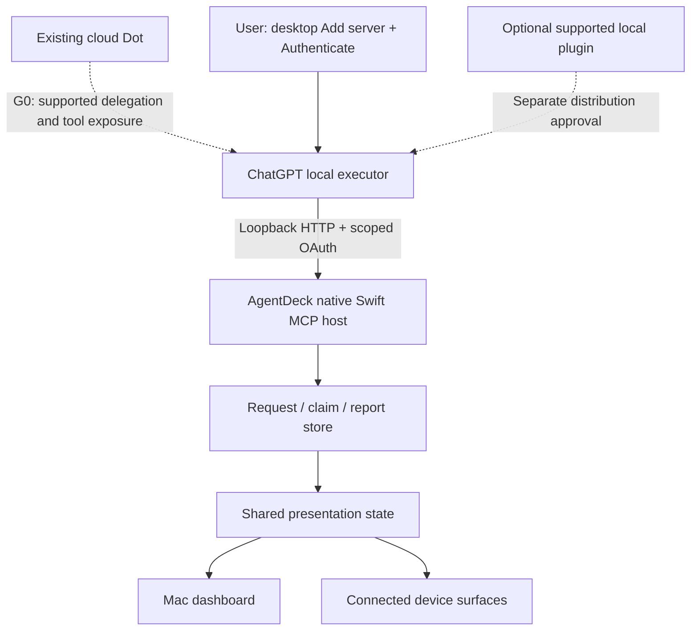

# Dot integration: development isolation and historical release plan

Reviewed: **2026-10-26**. This is a conditional delivery plan, not a declaration of platform approval or a shipped feature. It supersedes the ordering of the older [distribution plan](dot-distribution-decision.md#implementation-and-validation-order). The [feature matrix](appstore-feature-matrix.md) owns the App Store capability boundary; the [Korean overview](dot-connection-explained.ko.md) explains the earlier decision to users.

## Current release boundary — 2026-10-12

Dot development continues in this repository, but all Dot support is excluded from the
standard macOS and iOS builds. Explicit DotPreview configurations retain the native
implementation and tests. The [build/release contract](../RELEASING.md#dot-development-and-store-builds)
owns the configurations, artifact checks and future promotion procedure. AgentDeck's
Store release does not wait for Dot interoperability. Cloudflare is a candidate for
future development; this split implements no hosted backend and enables no service.

The server-free direction and gates below are the **2026-10-11 historical proposal**,
not the current Store feature set or a requirement to keep future research server-free.
A future public Dot release still needs transport, user onboarding, privacy and signed
candidate acceptance, followed by a new reviewed binary.

## Current local-route checkpoint — 2026-10-25

The preferred development route is **existing Dot → connected Mac task → plugin-side
native client → authenticated AgentDeck loopback host**. It avoids a publisher-operated
relay and user-managed API keys or tunnels. OpenAI still processes the delegated task
and any selected context returned to it; this is not local-only AI processing or an
offline service. A user-owned relay remains an advanced alternative, not required
ordinary-user onboarding.

An actual Dot delegated a synthetic request to its connected Mac on 2026-10-25. That
task explicitly invoked a Node client against localhost, and the correlated request
completed with sum **163**. This establishes local execution feasibility for that
measured client and host. That Node result alone did not establish the later native
route, automatic plugin exposure, clean-user setup or public plugin eligibility.
The [dated evidence](dot-distribution-decision.md#local-executor-checkpoint-2026-10-25)
supersedes the older conclusion that only the private tunnel had reached AgentDeck;
it preserves the earlier missing-tool observations for those tested configurations,
without treating them as a universal tool-inheritance rule.

The native client implementation passed **16 tests**, a Release build and actual
stdio `initialize`/`tools/list` discovery of four tools from a Developer ID-signed
executable. A separate validation-task smoke against the existing Node host verified
new read/report PKCE consent, login Keychain storage, `get_request` and `get_context`
from separate processes, refresh after access-token expiry, and disconnect. The
client's Keychain entry and test grant were removed, its request was purged, and the
two pre-existing grants were preserved. This was read-only request access by the
validation task, not actual Dot execution through the native client or report-write
acceptance. See the [native client evidence](../integrations/chatgpt-local/native/README.md#measured-validation-2026-10-25).

Update **2026-10-26**: the isolated Swift-host harness launched using an organization
Apple Development signature and a provisioning profile for the current Mac. Dedicated
sandbox-container and Data Protection Keychain-group checks passed, and the original
Swift host listened on `127.0.0.1:19476`. Denying the first native-client authorization
in the UI produced exit 1 / authorization required and zero host grants. Comparing
the second code and approving it produced `authorized: true`, client Keychain custody
and one host grant. Actual Dot reused its existing local task and ran six native-client
commands: `get_request` → `get_context` → `claim_request` → `report_update` working
sequence 1 → completed sequence 2 → final `get_request`. Every command exited 0.
The final marker matched the shared synthetic context, and **26 + 84 + 12 = 122**.
The host independently recorded working and completed; the validation task did not
claim or report on Dot's behalf.

This resolves the earlier `amfid -413: No matching profile` failure for the development
fixture, not for consumer distribution. Quitting and relaunching the harness restored
the grant and completed request. A read 419.8 seconds after grant approval succeeded,
beyond the initial access token's maximum 300-second lifetime; refresh may have
occurred earlier during Dot's calls, so its exact time was not measured. UI revocation
made the old client read fail with authorization required, client disconnect succeeded,
and a further read still failed. The host had zero grants and requests before it was
stopped and the harness quit. The installed AgentDeck app, its bundle identity, the
shared daemon runtime and standard Apple build exclusions
are unchanged. The app must neither launch/bundle the client nor prompt for a companion
installation. Harness results remain separate from a signed product archive.

[Desktop-only plugin documentation](https://developers.openai.com/plugins/deploy/desktop-only)
allows a bundled stdio MCP server in any supporting language/runtime, with its
dependencies. Public local MCP submission requires approved-partner eligibility and
the submitting organization's allowlist confirmation before review. Package the
authenticated native client explicitly as local MCP; the portal's documented
**Skills only** upload step for approved local MCP submissions is not an exemption
from that gate. A general skills-only `requires_local_executor` flag does not replace
the MCP credential contract or prove Dot tool exposure.

The native transport and Dot-delegation part of G0a is now demonstrated in this
prepared fixture. Installed-plugin exposure, supported onboarding, production-app
integration, the full lifecycle matrix and clean-profile acceptance still need evidence.
At that checkpoint the original plugin manifest remained the direct HTTP preview
and the native stdio package was only a template; that trial invoked the CLI explicitly.
The later package implementation and installed-stdio acceptance are recorded below. Existing
G0–G6 gates still apply to the claimed product scope; G0b's public support requirement
is not passed by a private run.

## Final local implementation checkpoint — 2026-10-26

The separate native package now includes a signed SwiftUI consent/revocation GUI
and the stdio client. The fixture package was installed with the official CLI.
The existing Dot-created worker explicitly ran that installed stdio transport and
completed six calls with the context-derived sum **158**. GUI revocation, rejected
subsequent access, zero remaining test grants/requests and temporary-install
cleanup passed. See the [current distribution checkpoint](dot-distribution-decision.md#installed-native-package-checkpoint-2026-10-26).

A subsequent loader diagnosis corrected a concrete package defect. Version 0.1.0
used `${PLUGIN_ROOT}/bin/agentdeck-local` as the stdio command; the desktop bundled
Codex 0.164.0-alpha.11.1 rejected it because Agent Plugins commands must be bare
executables or contained `./` paths. That version's missing-tool result was
confounded by the rejected command format, not proof of platform incompatibility.

With **0.1.1** and `./bin/agentdeck-local`, both the bundled 0.164.0-alpha.11.1 and
independent PATH 0.160.1 app-servers automatically discovered the native plugin
and all four tools. A model-free public API probe also dispatched its native
`get_request` and received the expected authorization-required error with no grant.
These are positive local loader/dispatch controls, not an actual Dot round trip.

Two new turns in the **existing Dot-created worker**, including one with the
documented plugin mention, still exposed zero native tools and nine existing
cloud tools. The corrected package was confirmed installed/enabled locally.
At that stage the inventory gap was measured only in this existing worker; a new
main-Dot delegation and fresh worker remained untested. These initial results did
not establish universal non-support or complete automatic Dot exposure.
The [distribution checkpoint](dot-distribution-decision.md#installed-native-package-checkpoint-2026-10-26)
records versions, timings and turn identifiers.

A later user request to the main Dot also reproduced zero native tools and nine
cloud tools. The delegation record for turn `01a17558-992c-711b-b1f5-a3dcfc3e9000`
explicitly reused the existing diagnostic worker; it did not create a fresh local
task. That result included actual main-Dot delegation, but still did not test
fresh worker initialization. The subsequent controlled test below addresses that
remaining distinction without CLI fallback or another AgentDeck consent.

The user then explicitly requested a **new** connected-Mac Codex task. Dot created
**Check native AgentDeck visibility**, task
`01a1755e-6f81-737f-b626-73effe9e600c`, on host `durable` with a new dated working
directory. Its first and only turn,
`01a1755e-79aa-7161-a4ed-398ee2b64d37`, inspected tool metadata and reported that
all four native tools were absent. It made no tool calls; the new worker's
cloud-tool count was not observed. The recorded delegation came from main Dot
thread `01a172aa-7c50-742c-b634-cfdd39cfc0d8`.

A fresh local app-server control on the same Mac discovered the correct 0.1.1
plugin and all four canonical schemas in **2.928 seconds**. The fresh-worker result
excludes old-worker configuration as the sole explanation, but a later global
registry failure prevents attributing the difference solely to platform delivery.
The control used a selected-marketplace inventory and did not exercise every
registered source. That first fresh Dot result is therefore pre-recovery
evidence, not a measured failure after all known configuration repairs.

A subsequent unfiltered `codex plugin list --json` failed because the original
`agentdeck-local-preview` marketplace referenced a deleted worktree source. The
source was recovered from the original cache's same five payload files plus a
marketplace manifest, then re-registered through the official CLI. Global listing
now succeeds; the original plugin remains installed/enabled, installed payload
hashes are unchanged, and authentication and endpoints were not modified. The
recovery receipt records the native fixture as not installed at that snapshot.
See the [registry recovery record](dot-distribution-decision.md#marketplace-registry-recovery-2026-10-26).

After reinstalling the fixture, the updated diagnostic passed the unfiltered
global inventory and exact four-tool discovery in **1.165 seconds**, without
consent or tool calls. A subsequent user request made Dot create another new task,
**Inspect native fixture tools** (`01a1757c-edba-7402-b3e4-fe29c7ce9022`). Its first
and only turn, `01a1757c-f794-763f-9959-55921921ee8d`, again reported all four
native tools absent, in **16.159 seconds**. Codex task records independently
verified the task ID and delegation from main Dot
`01a172aa-7c50-742c-b634-cfdd39cfc0d8`; the worker did not know its own task ID.
It inspected metadata only and made no tool calls, file accesses, CLI/HTTP
fallback, consent or other actions. The fresh task's cloud-tool count was not
measured. Its `durable` host label and new Mac working directory do not identify
the effective executor or MCP configuration.

The same-time strengthened local control passed global inventory, exact 0.1.1
plugin identity and four canonical schemas in **0.964 seconds**, using bundled
Codex **0.164.0-alpha.11.1**. The manifest SHA-256 was unchanged:
`ba93334fc006d6ed94b70575630fb850115b3ea60b502be8c4b251445b300fb4`.
The separate evidence files are `dot-native-exposure/post-recovery-fresh-dot-worker.json`
and `dot-native-exposure/post-recovery-dot-local-control.json`; the
[post-recovery checkpoint](dot-distribution-decision.md#post-recovery-dot-worker-checkpoint-2026-10-26) records the full boundary.

The two known configuration repairs did not restore native-tool exposure in this
tested Dot path. Retained configuration in only the original worker cannot fully
explain the repeated result. Effective executor configuration, application-wide
caching, routing and account/platform policy remain unverified; universal Dot
non-support and account policy denial are not established. G0 remains blocked.
After the test, the temporary fixture installation and staging marketplace were
removed through the official CLI; the original HTTP registration remains repaired
and its authentication and endpoint were not changed.

Subsequent runtime inspection found that the actual ChatGPT **26.1021.31345
(build 21828)** desktop app-server also logged the native fixture as `ready`.
The local controls and plugin app-server copy use the same bundled binary, and
local configuration inspection found no project/profile override or AgentDeck
deny filter. However, Dot's durable connection and separate local `exec-server`
use a capability-registration path: the desktop reads installed/enabled custom
plugin roots from its LOCAL host, registers them, and retains them in
`registeredPluginRoots`. The inspected built-in exclusion filter does not exclude
custom AgentDeck packages. The roots actually reported to the failing Dot task
were not observed.

Explicit registration refresh call sites were found, but no generic watcher for
CLI custom-plugin changes. A narrower route was then traced: the standard local
plugin UI's Enable/Disable handler writes configuration and calls
`browserPluginConfig.syncAfterPluginChange`, whose main-process callback invokes
`refreshConversationExecutorPlugins`. Full desktop startup also rereads roots;
network reconnect and power resume only report cached roots. The fixture was
reinstalled without a grant, and the preparation check passed global inventory
and four-tool discovery in **1.428 seconds**. The
[runtime/cache checkpoint](dot-distribution-decision.md#desktop-runtime-and-registration-cache-checkpoint-2026-10-26)
records that source boundary and the exact build/process/configuration evidence.

The user then completed **Disable → Enable** of the fixture on SBStudio. The
configuration modification time changed and `enabled: true` was confirmed. Two
metadata-only follow-ups in the existing **Check fresh native tools** task
(`01a17591-50f2-7716-86d6-2e60e7fd90e6`, host `durable`) still found zero native
tools, excluding nine cloud tools. Both fixture skills, `agentdeck-report` and
`setup`, were visible at the exact installed 0.1.1 cache root. No before-toggle
skill observation exists, so the skills cannot be described as newly appearing.
These were existing-task follow-ups, not a new first-turn test; no skill file or
AgentDeck tool was called and no consent occurred. The
[UI refresh checkpoint](dot-distribution-decision.md#plugin-ui-refresh-checkpoint-2026-10-26)
records the exact root, turn IDs and `after-ui-toggle-dot-result.json` evidence.

The whole package is not absent from this task's catalog. Complete package
omission or stale root registration alone cannot explain visible fixture skills
with missing native tools. The unresolved boundary is now skill delivery versus
MCP configuration/tool exposure, including possible MCP-specific cache, format,
executor or policy behavior. The subsequent legacy-format **0.1.2** fixture uses
`.codex-plugin/plugin.json` and `.mcp.json`, without the modern root manifests.
It retains the same binary, plugin ID, account and port 19476 and was installed
through the official CLI. The relative-command/placeholder-cwd attempt returned
`ENOENT` in local status. The separate placeholder-command attempt failed tool
discovery without an inspected underlying error. An exact installed absolute
command then passed local identity and
four-schema discovery in **3.057 seconds**, without tool calls or authorization.
That machine-specific diagnostic command is not a portable deployment solution.

Dot's next metadata follow-up, `01a175a4-eb67-74f2-bcfe-3d21a87ee561`, still
reported zero native tools and two skills rooted at **0.1.1**. Although 0.1.2 is
installed, no 0.1.2 root was observed in Dot. Its legacy-format compatibility is
therefore **untested**, not disproven. The
[legacy comparison checkpoint](dot-distribution-decision.md#legacy-mcp-format-comparison-checkpoint-2026-10-26)
records the executable hash and this initial version mismatch.

At approximately **19:03 KST**, the user confirmed the 0.1.2 UI Disable/Enable.
The same task's follow-up `01a177aa-892d-77c5-b33f-8a72de09e089` then reported
**zero native tools and zero fixture skills**, excluding nine unrelated cloud
tools. Neither 0.1.1 nor 0.1.2 fixture roots were visible. The actual desktop
app-server PID 55259 nevertheless launched 0.1.2 children observed from 19:02:43;
the inspected log window had eight `ready` events and no failed events. These
are local events, not Dot tool exposure.

Public local `plugin/installed` and `skills/list` confirmed installed/enabled
0.1.2 and two valid skills with no marketplace or fixture-skill errors. Including
14 local project paths returned by `list_projects` produced the same result,
without proving the live executor's complete root list. The selection code prefers
`localVersion`, so `version: null` is not a demonstrated cause. No readiness error
matched the tested task/turn in the bounded log window; unrelated global warnings
are not causal evidence. An unchanged config timestamp does not disprove the
user's toggle. The
[post-legacy UI checkpoint](dot-distribution-decision.md#post-legacy-ui-verification-2026-10-26)
records these separate controls and limitations.

The same toggle is not being requested again. Actual 0.1.2 capability delivery to
Dot remains unobserved, leaving the legacy-format comparison inconclusive and
the platform registration/capability boundary unresolved. **Automatic Dot release
is NO-GO** until a supported path passes; this is not a universal non-support
verdict. G0 remains blocked.

In the separate installed-0.1.1 GUI check, the Connect app launched and correctly
explained a connection failure with the fixture host off. After the approved isolated host was
started and code-matched `read/report` consent completed, the app-server's public
API dispatched all six request/context/claim/working/completed/final-read calls
through the automatically loaded native MCP. The context-derived sum was **179**;
the host independently observed both reports. GUI revocation then made the next
MCP read fail with authorization required in **0.246 seconds**. Test grants and
requests returned to zero, the host stopped and the fixture app quit. This
model-free local API cycle validates the installed GUI and authenticated plugin
transport; it is neither a Dot-worker result nor a Directory Run setup or
clean-user installation test.

Gatekeeper assessment of the actual installed Connect app returned **exit 3** with
`source=Unnotarized Developer ID`. Its launch on this prepared Mac does not resolve
that measured consumer-distribution blocker. A notarized artifact and a fresh-user
installation test remain required.

G0a's prepared native execution and authenticated local plugin cycle have passed;
supported Dot tool exposure and G0b's ordinary-user onboarding remain open. Version 0.1.1's
new `onboardingSkill` has passed manifest/skill validation only, not its real Run
setup journey. Public partner eligibility and organization allowlisting are
separate unverified requirements. The default-port ZIP is a signed preview, not
a notarized consumer artifact; the ordinary Store app still excludes Dot and has
not passed product-host/device acceptance. None of these local controls authorizes
a general Directory or Store release.

The available full verification run passed Apple Debug/Release/DotPreview, iOS,
Android, native Swift, packaging and other build gates. Its single Vitest failure
was a missing Korean report translation; after correction, the entire Vitest
coverage step passed **6,860 tests** with **17 skipped**. The original failed receipt
is retained alongside the corrective run, not rewritten as one all-green full run.
macOS opt-in E2E, Windows runtime and manual hardware/Swift-owner gates were not
attested in this run. These checks do not constitute release approval.

## Decision (historical)

Keep the no-public-server requirement. Target an **in-process Swift MCP host reached by an officially supported local ChatGPT executor**. Investigate the documented desktop **Add server + OAuth** flow first; public plugin directory admission is a separate, potentially smoother distribution route. Do not assume every local integration needs a public directory listing.

There is currently **no verified complete route for ordinary users' existing Dot** that satisfies this product contract. The corrected native package loads automatically in the tested local Codex app-servers. After the native command and stale-marketplace registration were repaired, another newly created Dot task still lacked all four tools while the same-time global-inventory/local-loader control passed. Those repairs are insufficient for the tested path. The actual desktop app loaded the fixture; its separate Dot capability-registration cache is now a specific unconfirmed hypothesis. After the user completed the plugin UI Disable/Enable, two existing-task follow-ups still lacked native tools while showing both fixture skills at the exact 0.1.1 root. Complete package omission or stale root registration alone is insufficient; MCP configuration-format handling, MCP-specific state, effective executor configuration and policy remain unresolved. The legacy 0.1.2 fixture passes local four-tool discovery using a machine-specific absolute command. After the confirmed UI toggle, Dot reported neither fixture tools nor skills, while local installation, skill inventory and actual desktop startup remained successful. Delivery of the 0.1.2 root to Dot is unobserved, so legacy-format support remains untested and the registration/capability boundary remains unresolved. Automatic Dot release is NO-GO; the same toggle is not being requested again. Public local-MCP distribution additionally requires approved-partner eligibility and organization allowlisting; the private tunnel is not public distribution. These are separate gates, not one generic “MCP unsupported” conclusion.

An App Store launch of automatic Dot integration is **no-go until the local route passes Gate 0** below. AgentDeck's independent features can continue releasing. Do not add more device work or embed a tunnel binary to conceal an unresolved transport gate.

“App only” means AgentDeck needs no additional AgentDeck helper, Node runtime, terminal setup, Platform key, tunnel identity, public port, domain or hosted backend. Users still need eligible Dot access, the existing ChatGPT desktop app, computer permission and explicit local authorization. This is not an offline product. Public documentation/privacy pages or a static client metadata document are distinct from operating a public MCP service; prefer OpenAI-hosted client metadata where supported.

## Official evidence and its limits

| Route | What is officially documented | What remains missing | Decision |
|---|---|---|---|
| Desktop local HTTP MCP | ChatGPT desktop Settings → MCP servers → Add server accepts Streamable HTTP; Authenticate starts OAuth. Same-host Codex clients share configuration; cloud/web execution does not read local Codex configuration. [MCP documentation](https://learn.chatgpt.com/docs/extend/mcp) | Whether the separate Dot capability-registration path provides the tools; consumer account eligibility; GUI-only authentication with AgentDeck | Resolve the actual executor and registered roots; the cloud/web configuration distinction is not a blanket Dot prohibition |
| Dot computer access | Dot can create local Work/Codex tasks and continue local Codex tasks; computer must be online with ChatGPT open. [Computers and apps](https://learn.chatgpt.com/docs/dots/computers-and-apps) | A cloud-coordinated task using local files is not necessarily a local MCP-capable executor | Prove tool availability and execution provenance on the actual Dot-created task |
| Public local MCP plugin | Approved partners can submit a desktop-only stdio MCP package with its dependencies; organization allowlisting precedes submission. Installation is desktop-only and mentions are limited to locally running threads. [Desktop-only plugins](https://developers.openai.com/plugins/deploy/desktop-only) | This publisher's eligibility, consumer signing/notarization, onboarding, install/update and actual Dot tool exposure; local marketplace installation does not prove public admission | The private package now loads locally; obtain the required support/review and demonstrate the selected Dot surface before claiming public availability |
| Managed orchestrator policy | For Work with local access and dots, supported Global policy applies through the shared cloud orchestrator when managed policy is enabled; apps, MCP servers and plugins are configurable available tools. [Orchestrator controls](https://learn.chatgpt.com/docs/enterprise/agent-security#orchestrator-controls) | Whether managed policy applies to this account and the effective policy of the tested task were not inspected | A possible configuration boundary to resolve through supported diagnostics; not evidence of an account policy denial |
| Private workspace plugin | Admin publication distributes within the workspace/org. [Workspace publication](https://developers.openai.com/plugins/build/plugins#publish-a-local-plugin-to-your-workspace) | Availability outside that workspace and Dot's local execution path | Team pilot, not arbitrary consumer distribution |
| Official Secure MCP Tunnel | Outbound client reaches a private MCP server. Public plugin submission/distribution is excluded. [Tunnel guide](https://developers.openai.com/api/docs/guides/secure-mcp-tunnels) | A documented native embedding/provisioning route for consumer apps; public distribution permission | Keep current experiment private; do not ship publisher credentials or require user API keys |
| Skills-only package | MCP configuration is excluded; persistent credentials/settings need MCP in the migration guidance. [Supported migration scope](https://developers.openai.com/plugins/guides/submit-claude-plugin#review-what-openai-supports) | Skills alone do not install authenticated local transport | Optional instructions only; no token-in-prompt or shell-script workaround |
| Sign in with ChatGPT | Identity and eligible model-usage flows have distinct scopes. [Identity](https://developers.openai.com/siwc/website), [model usage](https://developers.openai.com/siwc/token-sharing-open-source) | Neither establishes a route to the user's existing Dot | Do not build an account backend to solve a transport problem |
| MCP Events | Authorized server-originated events can activate a workflow. [Events](https://developers.openai.com/plugins/build/mcp-events) | Supported subscription, callback and return-tool path | Optional subsequent release; not a feed of all Dot activity |
| App Intents / Shortcuts | Apple exposes app actions to its system experiences. App Shortcuts are not supported on macOS; App Intents actions can participate in user-created Mac shortcuts. [Apple guidance](https://developer.apple.com/design/human-interface-guidelines/app-shortcuts) | No reviewed OpenAI contract establishes automatic Dot discovery/invocation or authenticated reporting | Useful generic automation later; not the chosen Dot transport |
| Native computer use / browser UI | Dot has computer access, subject to execution environment and permissions. [Computers and apps](https://learn.chatgpt.com/docs/dots/computers-and-apps) | Reliable unattended execution, locked-screen behavior, caller identity and progress reporting | A bounded usability experiment only; clicking a status control does not prove a Dot-originated report |

No public personal-Dot global-status, automatic avatar export or general remote-control API was established by this review. This is a bounded finding, not a claim about undisclosed interfaces. A public HTTPS reverse proxy, including a managed tunnel/Funnel, still exposes a public MCP endpoint and changes the selected constraint.

## What the implementation actually proves

The merged [PR #501](https://github.com/puritysb/AgentDeck/pull/501) and dated [validation record](dot-distribution-decision.md#real-account-validation) prove a useful private chain: real Dot calls, correlated request claims and reports, Node daemon state, Mac creature motion/completion and rendered Pixoo preview updates. The installed-main trial also measured report-to-WebSocket delays of approximately 650 ms and 2,263 ms. These are observations from one trial, not latency guarantees. Physical Pixoo photography and all-device acceptance were not completed.

That chain still uses an external official tunnel client, Node adapter and Node daemon. It proves neither app-only execution nor a signed sandboxed Swift Release. Earlier local-task failure happened before `get_request`; another consent approval cannot fix absent tools.

Source inspection identifies a concrete local-onboarding gap:

- [DotOAuth.swift](../apple/AgentDeck/Daemon/Dot/DotOAuth.swift) advertises PKCE, public-client authentication and issuer-bound responses, but validates a pre-registered client ID. It does not advertise DCR or CIMD. The local redirect validator requires the shared callback path and a valid loopback port.
- [DotHost.swift](../apple/AgentDeck/Daemon/Dot/DotHost.swift) configures the local listener and native consent. The [private plugin README](../integrations/chatgpt-local/README.md) already records the pre-registration limitation.
- Official desktop documentation supports automatic CIMD/DCR as well as pre-registration. Its GUI instructions do not establish a GUI field for our fixed client ID. A generic Add server flow therefore cannot be assumed to authenticate against today's implementation.
- [App entitlements](../apple/AgentDeck/Resources/AgentDeck.entitlements) already declare Sandbox plus incoming/outgoing network permissions. This is source evidence, not proof of the entitlements or behavior of a submitted archive.

Update 2026-10-11: the G0b registration spike closes the first three gaps in both hosts. The loopback host now accepts a `chatgpt.com` client metadata document or a bounded secretless loopback registration besides the pre-registered client, and consent still gates every grant. Codex CLI 0.160.1 completed `auto`, `cimd` and `dcr` sign-in against an isolated host with a URL-only configuration ([plugin README](../integrations/chatgpt-local/README.md)). The desktop Add server GUI and the signed sandboxed Swift host were not exercised live.

## Target architecture and user experience

The current preferred plugin path adds a native stdio client between the ChatGPT
local executor and the Swift HTTP host. The direct desktop HTTP path below remains
an alternative to test. The client runs on the plugin side, not as a subprocess of
AgentDeck. Its own consented, revocable credential must remain outside prompts,
tool results and plugin archives. OpenAI's remote HTTP OAuth documentation does not
by itself establish automatic localhost authorization UI or shared Keychain access
for a stdio helper; those contracts require implementation and live validation.

The dashed edge still requires a supported product setup and automatic tool exposure. The 2026-10-26 private fixture demonstrated Dot delegation with explicit native CLI invocation. Preserve the delegating actor, authenticated local grant and actual executor separately. Model-written labels do not authenticate Dot identity.

Proposed initial flow, only after the relevant gates pass:

1. In AgentDeck, enable the local connection. Start the in-process listener; offer **Copy connection address**. Show its real readiness/error state.
2. In the existing ChatGPT desktop Settings, add that HTTP address and select Authenticate. Prefer the client's documented automatic registration so users enter no client IDs or secrets. Do not write another app's configuration or invent an install deep link.
3. Approve selected-context read and request-report scopes in AgentDeck. Computer access is a separate permission in Dot's profile when not already granted.
4. Give the existing Dot a one-time request reference. Verify actual read, claim and completion before showing **Ready**. Do not mark ready merely because the MCP client connected.
5. Persist revocable grants in Keychain. Reconnect without repeating valid permissions. Later add a one-click plugin only if OpenAI supplies a supported local distribution mechanism.

This intentionally permits a short settings-based first setup; it removes operational server/key management. It is not advertised as zero configuration. Measure whether non-developer testers can finish it unaided before launch.

### Native authentication work, conditional on feasibility

Choose **one documented registration mode** after checking the supported desktop versions. CIMD with trusted OpenAI-hosted metadata could avoid running a public registration service; DCR is an alternative if required by the supported client. Neither grants tool access without the user's local consent.

Keep S256 PKCE, state and issuer checks, exact resource/audience binding, bounded requests, loopback redirect validation, refresh rotation, expiry, revocation and Host/Origin protection. For CIMD, constrain metadata URLs/redirects and outbound fetches against SSRF; for DCR, bound registration volume and do not treat registration as authentication. Validate the exact client callback behavior documented in [MCP OAuth](https://learn.chatgpt.com/docs/extend/mcp). Do not loosen existing checks simply to make a login succeed. Never use ChatGPT session cookies or treat the first-party `auth=chatgpt` option as third-party authorization.

Changes to OAuth/resource rules require shared-contract ownership, Node/Swift parity and meaningful regression tests. Existing request/report/rendering code should be reused, not rewritten around the experimental tunnel.

## Release gates, in order

| Gate | Work and proof artifact | Pass criterion / stop condition |
|---|---|---|
| G0a: local execution feasibility | On an isolated supported desktop profile, exercise native AgentDeck HTTP MCP through a supported native plugin client or the documented direct host flow. Test local Codex, Dot-created local Codex, and cloud-coordinated local Work separately. Record host/executor identity and tool inventory, not just the working directory. | Actual Dot completed the correlated native CLI/isolated Swift-host cycle without tunnel/Node adapter. Corrected package 0.1.1 loads four tools automatically in both tested local app-servers; the model-free public API also completed the authenticated six-call cycle and revocation. Three existing Dot-worker turns and a newly created task lacked native tools before a stale marketplace source was repaired. After recovery and fixture reinstallation, another new Dot task still reported no native tools while the same-time global-inventory and exact-plugin control passed. The known repairs are insufficient for that path. After the UI Disable/Enable action, two existing-task follow-ups showed the exact fixture skills/root but no native MCP tools; complete package omission or stale root registration alone is insufficient. After the 0.1.2 toggle, the same task had no fixture tools or skills while local 0.1.2 installation, skills and actual desktop startup passed. Delivery of that root to Dot is unobserved; format support and effective registration/policy remain unverified. G0 remains blocked pending Dot tool-exposure acceptance, without a universal non-support verdict. Pass the actual supported Dot inventory and request cycle separately; neither explicit CLI execution nor local loader success completes that gate. |
| G0b: supported onboarding | Check actual GUI registration capabilities. If registration alone blocks local auth, make a minimal CIMD/DCR compatibility spike first. Ask OpenAI the questions below about Dot propagation and public local distribution. | A documented, reproducible route for the selected ordinary-user accounts. Direct Add server does not require directory approval, but Dot tool propagation must be supported and demonstrated. A private partner exception is not general availability. |
| G1: native product implementation | Native registration/consent, connection health, revocation and reconnect UI. Retain request provenance and freshness. Update feature matrix and shared contracts before code changes. | No shell, bundled/launched helper or companion prompt in AgentDeck; no user-installed language runtime or manual config/key editing. A plugin-side native client needs its own supported packaging and credential lifecycle. Existing ChatGPT account/computer grants remain distinct. |
| G2: fresh-user installation | At least two independent eligible accounts on clean Mac profiles without developer credentials or previously installed local plugins. One uses only documented GUI setup. | Install → consent → first actual Dot result, restart and revoke all succeed. Record versions, account/workspace restrictions and setup steps. No reliance on the developer's account, cached tools or workspace publishing. |
| G3: lifecycle/security | Ten real correlated request cycles plus negative cases below; Node absent and Swift owning the daemon for Store acceptance. | No stuck working, false completion, cross-grant access or unbounded wait. Timings and error recovery recorded. Unsupported execution contexts are identified explicitly. |
| G4: presentation | Actual Dot reports on Mac 2D/3D and supported connected surfaces. Verify Stream Deck, D200H and physical Pixoo if these are claimed at launch; ESP32/mobile by the claimed surface matrix. | Appearance, working, completion, stale and disconnected states match the shared rules. Rendered preview is not physical-device proof. Optional external device software is not required for the core Mac experience. |
| G5: App Store candidate | Full recorded verification; signed Release archive; archive verifier; TestFlight clean install; reviewer walkthrough, privacy and accurate metadata. | All advertised capabilities work in the exact candidate. Core AgentDeck remains useful without Dot. Separate platform support from Apple approval. |
| G6: distribution | Follow the Apple release workflow and any separately required OpenAI distribution review. | Track CI success, artifact, upload, submission and live availability separately. Announce only the state actually observed. |

The UI Disable/Enable comparison did not restore native tools in the tested existing-task follow-ups, although the exact fixture skills/root were visible. The legacy 0.1.2 comparison passed local four-tool discovery only with a machine-specific absolute command. Dot first showed the 0.1.1 root and then no fixture skills after the user-confirmed 0.1.2 toggle. The legacy Dot hypothesis remains untested because delivery of 0.1.2 is unobserved. Do not repeat the same toggle as the next diagnostic; obtain version-correlated registration evidence. Keep these existing-task observations separate from portable packaging and an authenticated request cycle.

G0a and G0b can inform each other: a small auth spike is justified to answer feasibility; a broad feature rollout is not. No delivery date is credible before G0. Do not keep re-running the already successful private tunnel test as a substitute for G0.

G3 includes: foreground/background; closing the dashboard window versus quitting AgentDeck; closing a ChatGPT window versus quitting the app; Mac lock, sleep/wake, network loss, restart, OAuth rejection/expiry/revocation, account/workspace change, port collision, duplicate/out-of-order reports and concurrent requests. Closing a window is not process termination. Failure to reach the Mac says nothing about cloud Dot activity. Retain completed history and distinguish unavailable, stale and explicitly completed states; silence never creates a completion.

Events are **outside the first release acceptance target**. Initially the user asks Dot to process an explicitly shared request. A hardware key must not claim it automatically wakes Dot. Add that feature only after real subscribe → verification → delivery → Dot execution → report → unsubscribe passes through a supported return path. Keep reporting scope separate from event-subscription authority.

## Apple review preparation

Apple documents sandbox incoming networking through [`com.apple.security.network.server`](https://developer.apple.com/documentation/bundleresources/entitlements/com.apple.security.network.server). A native loopback listener is not inherently barred simply because it is a server. Mac App Store rules require appropriate sandboxing and self-contained packaging; metadata and review access must reflect the real product. AgentDeck's core functionality must work independently. [App Review Guidelines, 2.3, 2.4.5 and 4.2.3](https://developer.apple.com/app-store/review/guidelines/)

The repository's stricter no-subprocess/no-helper rule remains binding; it should not be presented as a universal Apple prohibition on every subprocess. Optional interoperability with an already-used ChatGPT account still needs a clear review explanation, and no architecture guarantees approval.

Before submission:

- Provide an exact reviewer path and a permitted test arrangement for Dot access, including known plan/version/region prerequisites. A recording or simulated report cannot replace reviewable functionality; label diagnostics as simulated.
- Explain selected context sent to OpenAI, user authorization, local retention/deletion, revocation and request-scoped status. Reconcile the App Privacy answers and privacy policy with the real flow; do not claim local-only data processing.
- Exclude unsupported experiment controls from the public release scope and describe any retained reachable functionality accurately. Do not conceal functionality from reviewers or remotely enable unreviewed functionality afterward.
- Avoid global activity/automatic avatar sync claims and verify permissions for any brand assets. User-imported images remain a separate bounded feature.
- Run `pnpm verify:full --record` and the [Apple release procedure](../RELEASING.md), including `apple/scripts/verify-appstore-archive.sh` on the signed Release candidate. Prior private runtime receipts do not satisfy this gate.

## Questions for OpenAI — prepared, not sent

The latest evidence is from **2026-10-26**. Explicit installed-stdio execution by
the existing Dot worker completed the authenticated request cycle. The initial
0.1.0 package also had a real command-format defect; after correction, 0.1.1 loads
four native tools automatically in both tested local Codex app-servers. Existing
and explicitly new Dot-directed Mac tasks lacked those tools. A later unfiltered
plugin list exposed an additional stale marketplace source that the filtered local
control had bypassed. Source recovery restored global enumeration without changing
the original plugin payload or authentication. A new Dot task after recovery
and fixture reinstallation still lacked all four native tools, while a same-time
control passed unfiltered global inventory and exact plugin/schema discovery.
The two known repairs are insufficient for the tested path; effective executor
configuration, application-wide caching, routing and account/platform policy are
not isolated. Preserve both the earlier confound and the post-recovery comparison
in the inquiry; do not present them as proof of universal platform non-support.
A later read-only desktop/runtime investigation found a distinct cached
capability-root registration path, while the actual desktop local app-server
successfully loaded the plugin. The live Dot roots remain unobserved. The draft
now asks how the registered plugin's skills and MCP tools are exposed separately.
After the user completed the UI Enable/Disable, two existing-task follow-ups still
lacked native tools but showed both skills at the exact fixture root. This does
not establish that the toggle introduced the skills; no before-toggle skill
measurement exists. The legacy 0.1.2 fixture then passed local discovery with an
absolute command after relative/placeholder launch failures, but Dot still showed
the 0.1.1 skill root. After the user confirmed the requested 0.1.2 UI toggle,
the same task showed neither fixture tools nor skills. Local installation, skills
and actual desktop startup still passed. The legacy Dot test remains inconclusive
because 0.1.2 delivery is unobserved. Preserve the local/Dot distinction, bounded
error-log findings and machine-specific command limitation in the inquiry; no
further identical toggle is being requested.

Use the contact/support route in the
[desktop-only submission guidance](https://developers.openai.com/plugins/deploy/desktop-only).
The following draft is prepared only; no message or public submission has been sent.

> AgentDeck has a native authenticated loopback MCP host and a separate desktop
> plugin containing a signed Swift stdio client and consent/revocation GUI. Our
> prepared Mac test needs no user API key, tunnel or publisher relay. An existing
> Dot-created connected-Mac worker completed request/context/claim/progress/result
> calls when it explicitly launched the installed stdio executable. We corrected
> a rejected stdio command to `./bin/agentdeck-local` in version 0.1.1. Both Codex
> 0.164.0-alpha.11.1 and 0.160.1 app-servers now discover its four tools automatically.
> Diagnostic turns of the existing Dot worker, including a plugin mention, and
> actual main-Dot delegation still showed nine existing cloud tools and no native
> tools. We then explicitly asked Dot to create a new connected-Mac Codex task
> instead of reusing that worker. Its first turn also reported all four native
> tools absent. It inspected metadata only and made no tool calls; we did not
> record the fresh task's cloud-tool count.
>
> Recorded reproduction before global registry recovery:
>
> 1. Install and enable fixture plugin 0.1.1, using
> `./bin/agentdeck-local`. Plugin manifest SHA-256:
> `ba93334fc006d6ed94b70575630fb850115b3ea60b502be8c4b251445b300fb4`.
> 2. A fresh independent bundled 0.164.0-alpha.11.1 app-server on the same Mac
> discovers the exact plugin identity and four canonical input schemas in 2.928 s.
> 3. Main Dot thread `01a172aa-7c50-742c-b634-cfdd39cfc0d8` creates task
> `01a1755e-6f81-737f-b626-73effe9e600c` (**Check native AgentDeck visibility**,
> host `durable`, new dated Mac working directory). Its first and only turn
> `01a1755e-79aa-7161-a4ed-398ee2b64d37` reports no native tools after 8.486 s.
> No CLI fallback, authorization or actual MCP call was used in that task.
>
> We subsequently found a configuration confound. Global `codex plugin list
> --json` failed because the existing `agentdeck-local-preview` marketplace pointed
> to a deleted worktree source. Our local diagnostic had selected only the fixture
> marketplace, bypassing this failure. We recovered the original source from its
> unchanged five cached payload files plus the marketplace manifest and used the
> official CLI to re-register it. Global listing now succeeds, the original plugin
> remains installed/enabled, and its payload hashes, authentication and endpoint
> are unchanged. The recovery snapshot records the native fixture as not installed.
>
> Post-recovery reproduction, after reinstalling the same fixture:
>
> 1. Require successful unfiltered global plugin inventory, then exact fixture
> identity, version 0.1.1 and the unchanged manifest hash above. A fresh bundled
> 0.164.0-alpha.11.1 app-server discovers all four canonical schemas in 0.964 s.
> No authorization or AgentDeck calls are made by this control.
> 2. The same main Dot creates another task, `01a1757c-edba-7402-b3e4-fe29c7ce9022`
> (**Inspect native fixture tools**). Its first and only turn,
> `01a1757c-f794-763f-9959-55921921ee8d`, reports all four native tools absent after
> 16.159 s. It uses only initial tool metadata, with no calls, file accesses,
> CLI/HTTP fallback or consent. Its cloud-tool count is unknown.
> 3. Codex task records independently identify that new task and source Dot. The
> recorded `durable` host and new Mac working directory do not establish which
> executor or effective MCP configuration supplied its tools.
>
> The two known configuration repairs did not restore the tested Dot path. This
> is not a universal support verdict: effective executor configuration,
> application-wide caching, routing and account/platform policy remain unverified.
> The temporary fixture installation and staging marketplace were removed after
> the test; the original HTTP registration remains repaired, with authentication
> and endpoint unchanged.
>
> A subsequent read-only investigation of ChatGPT 26.1021.31345 (build 21828)
> found successful native-fixture startup in the actual desktop local app-server,
> matching local binary/configuration controls. The durable cloud connection uses
> a separate local executor. The desktop reads installed/enabled custom plugin
> roots from its LOCAL host, registers `selected_capability_roots`, and uses cached
> `registeredPluginRoots` for per-thread readiness reports. The built-in-only
> exclusion filter does not exclude this custom package. We found explicit refresh
> call sites but no generic CLI custom-plugin installation watcher. The standard
> local-plugin UI Enable/Disable callback writes configuration, calls
> `browserPluginConfig.syncAfterPluginChange`, and reaches
> `refreshConversationExecutorPlugins` through the main-process change callback.
> Reconnect and resume report cached roots; full app startup rereads them. We did
> not observe the actual roots registered for the failing Dot task. This suggests
> a registration-refresh hypothesis, not a confirmed cause. Fixture 0.1.1 is now
> reinstalled without a grant, with the 1.428 s local preflight passing. The user
> then completed Disable/Enable on SBStudio; the configuration modification time
> changed and the fixture ended enabled. Two metadata-only follow-ups in the
> existing task **Check fresh native tools**
> (`01a17591-50f2-7716-86d6-2e60e7fd90e6`, host `durable`) still found zero native
> tools, excluding nine cloud tools. The fixture skills `agentdeck-report` and
> `setup` were visible at the exact installed 0.1.1 plugin cache root. We did not
> measure skills before the toggle, so we cannot claim they newly appeared. These
> are existing-task follow-ups, not a new task's first turn; no skill files,
> AgentDeck calls or consent were used. Complete package omission or stale root
> registration alone cannot explain the skill/MCP difference.
>
> We then installed diagnostic version 0.1.2 through the official CLI, using
> `.codex-plugin/plugin.json` and `.mcp.json` without modern root manifests. The
> native binary, plugin ID, account and port 19476 are unchanged. The relative
> command plus placeholder cwd returned ENOENT in public local status. The separate
> placeholder-command attempt failed tool discovery; its underlying error was not
> inspected. An exact installed absolute command passed an independent local
> app-server control with four canonical schemas in 3.057 s, without authorization
> or actual calls. This is machine-specific diagnostic configuration, not a
> portable distribution solution. Dot follow-up
> `01a175a4-eb67-74f2-bcfe-3d21a87ee561` still reported zero native tools and two
> skills at the old 0.1.1 root; it did not show 0.1.2. This is not a valid Dot test
> of legacy-format compatibility.
>
> The user then confirmed the 0.1.2 UI Disable/Enable at about 19:03 KST. Follow-up
> `01a177aa-892d-77c5-b33f-8a72de09e089` in the same task reported zero native tools
> and zero fixture skills; neither the old nor new fixture root was visible.
> The actual desktop app-server PID 55259 launched 0.1.2 children observed from
> 19:02:43 KST, and its bounded startup log contained eight ready events and no
> failed events. Public local `plugin/installed` showed installed/enabled 0.1.2;
> `skills/list` returned both valid skills with no relevant errors. Including the
> 14 local project paths available through `list_projects` gave the same result,
> but we have not observed the live executor's complete root list. The root
> selection code prefers `localVersion`, so the separate `version: null` field
> does not explain omission under that code path. No readiness error was correlated
> with this task/turn in the 19:01–19:10 KST window. Unrelated global warnings and
> an unchanged config timestamp do not establish registration failure or disprove
> the user's toggle. We are not requesting the same toggle again. The 0.1.2 root
> remains unobserved in Dot, so neither its format support nor rejection is proven.
>
> 1. Which supported desktop/Dot execution surface loads a third-party bundled
> stdio MCP server? Does it include cloud-coordinated tasks on a connected Mac,
> and what additional installation or registration is required? How can we inspect
> the actual executor's registered capability roots and effective plugin
> configuration? The 0.1.1 task showed fixture skills without MCP tools, while the
> latest 0.1.2 follow-up showed neither despite successful local loading. Which
> supported diagnostic identifies the registered version and the boundary that
> omits these capabilities? Which MCP formats and tool-loading steps does this
> executor support? Does normal Directory installation invoke the
> same registration refresh automatically, and how can MCP-specific load failures
> be distinguished from skill delivery? Which portable command/root substitution
> is supported for the compatibility layout? The documented managed Global policy
> includes apps, MCP servers and plugins for dots
> when enabled; how can we establish whether that policy applies here without
> treating the missing tools as proof of denial?
> 2. Are we eligible for the approved-partner local MCP route, and what confirmation
> must the submitting organization obtain before upload? Please identify applicable
> plan, app version, region and workspace restrictions.
> 3. What is the supported first-install flow for launching local consent,
> recognizing host readiness, updating signed native dependencies and removal?
> The 0.1.1 package declares an `onboardingSkill`; manifest/skill validation passed,
> but the actual Run setup flow has not. Does that documented action support
> opening the bundled consent GUI in the relevant Dot/local execution surface?
> 4. Does that route carry authenticated delegation provenance? Are MCP Events
> subscriptions and return calls supported, and how does it recover when the Mac
> sleeps or ChatGPT quits?
>
> Please provide a minimal supported example or the unsupported boundary. We are
> keeping general Dot release disabled until automatic tool exposure and a clean
> consumer installation have been demonstrated on a supported route.

## Alternatives and explicit stop conditions

If native local Codex works but Dot cannot use it, release only accurately named local MCP interoperability after its own verification; do not rename it “Dot connected.” Keep automatic Dot integration private. A request export/import or clipboard workflow could provide user-assisted sharing, but it would not fulfill the live Dot integration goal.

If direct Add server works end-to-end but directory support is unavailable, the guided settings flow remains a candidate public app feature. Obtain/record the supported Dot execution scope, pass fresh-user and Store gates, and describe the extra setup honestly. Do not unnecessarily block that route on a directory listing.

If OpenAI offers a supported native tunnel SDK with consumer credential provisioning, reassess it against the same app-only and distribution criteria. No such complete offering was established in the reviewed documentation; do not reverse-engineer the current binary or assume its availability.

If neither route is supported, there is no honest way to promise all requested properties today. Continue shipping AgentDeck's independent features and preserve the integration work for later support. A public relay is a different product decision, not an automatic fallback.
