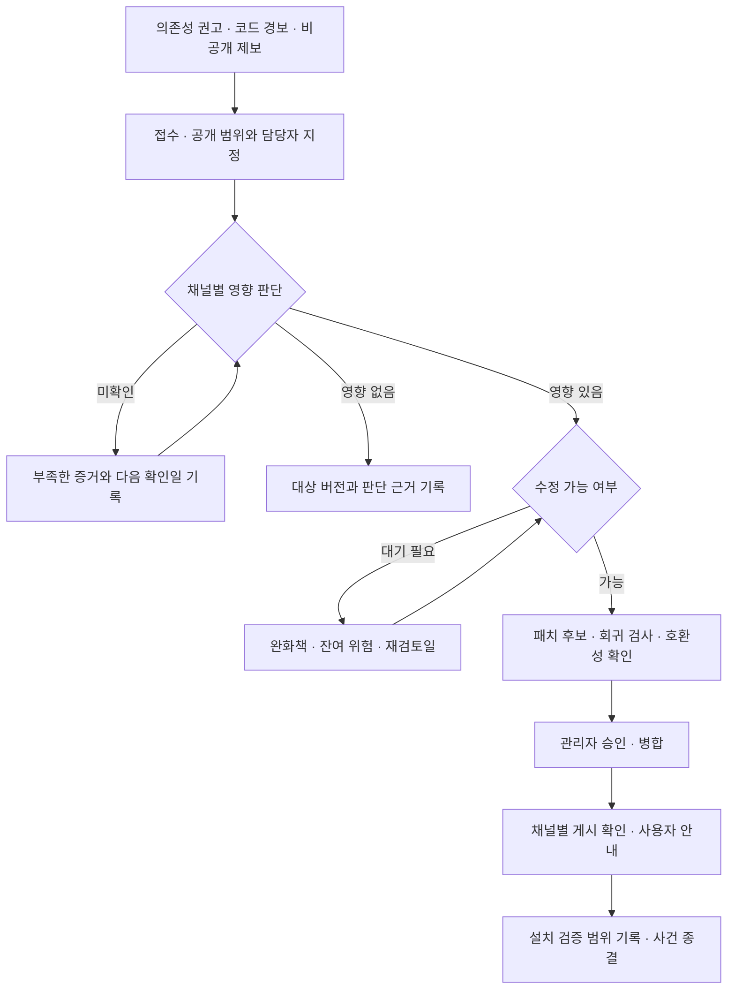

# AgentDeck 보안 이슈 대응

관리자(`puritysb`)는 경보를 받으면 **어느 채널의 어떤 버전이 영향을 받는지, 지금 사용자가 취할 수 있는 조치가 무엇인지** 판단한다. 미공개 제품 결함과 제보는 [비공개 제보 창구](https://github.com/puritysb/AgentDeck/security/advisories/new)에서 다룬다. 실행 시각과 결과는 [Actions](https://github.com/puritysb/AgentDeck/actions), 열린 경보는 권한이 있는 계정으로 [Security](https://github.com/puritysb/AgentDeck/security)에서 확인한다.

## 경보 한 건의 처리 흐름

아래는 관리자가 사용하는 절차다. 스캐너는 이미 운영 중이며, 사건 통합과 AI 판단서 생성은 아래의 도입 계획에 해당한다.

같은 사건도 Android 출시판은 ‘영향 없음’, npm은 ‘게시 완료’, ESP32는 ‘미확인’일 수 있다. 채널별 행을 유지하고, 열린 행에는 담당자와 다음 확인일을 남긴다. 스캐너 오류나 오래된 결과는 검사 복구 대상으로 접수한다. 마지막 성공 시각과 누락 기간을 기록하고 복구 후 그 기간의 공지를 다시 대조한다.

## 어디서 어떤 신호가 들어오는가

| 운영 중인 경로 | 관리자에게 알려주는 사실 | 다음에 확인할 것 |
|---|---|---|
| Dependabot 경보와 보안 업데이트 | GitHub가 알려진 권고를 의존성 그래프에서 찾았다. 수정 버전으로 올릴 수 있으면 PR이 생긴다. | 실제 배포 버전, 전이 의존 경로, 기존 PR. 주간 일반 업데이트는 별도 유지보수로 분류한다. |
| 일일 감사와 PR Dependency Review | npm·Python·Rust·Android 감사는 각 입력에서 알려진 권고를 찾는다. Dependency Review는 PR에 새로 들어온 의존성 변경을 검사한다. | 전체·개발·출시 의존성을 구분하고 수정 후 같은 범위로 재검사한다. 테스트 도구가 CI 자격 증명이나 릴리스 산출물에 접근하는지도 확인한다. |
| CodeQL과 월간 Snyk | CodeQL과 Snyk Code는 소스에서 의심되는 동작을 찾는다. 월간 Snyk Open Source는 pnpm 워크스페이스와 Android release/sideload 런타임을 알려진 권고와 대조한다. | 코드 경보는 입력의 출처와 권한을 추적한다. Snyk 신규 건수는 기준선과의 차이다. 기준선에 있다는 사실만으로 개별 검토 완료를 추론할 수 없다. |
| 비밀 탐지와 ESP32 구성 목록 | GitHub의 비밀 탐지와 자체 토큰 검사는 자격 증명 노출 후보를 찾는다. ESP32 목록은 보드별 SDK·도구·라이브러리 버전과 해시를 남긴다. | 유효한 비밀이면 비공개로 폐기·교체하고 사용 범위를 점검한다. SDK 공지는 보드 구성과 빌드 시 적용한 패치까지 대조한다. |
| 비공개 제보·제품 리뷰 | 인증, 기기 검색, 명령 생성처럼 제품 고유의 신뢰 경계에서 결함을 찾을 수 있다. | Node·Swift·펌웨어의 같은 경계와 업그레이드 전 설치 상태도 확인한다. |
| 검사 상태 감시 | 시간별 감시기가 의존성 감사와 CodeQL의 최근 결과 및 예약 실행을 점검한다. | 실행 실패, 경보 발견, 경보 없음은 각각 다른 결과다. 월간 Snyk 실행 기록은 별도로 확인한다. |

트리거, 실패 조건, 보관 기간과 검사별 한계는 [검사 운영 문서](security-scanning.md#automated-checks)에 있다. 월간 Snyk의 공개 이슈·실행 요약·아티팩트에는 건수만 남긴다. 관리자는 해당 커밋과 도구 버전으로 비공개 환경에서 상세 결과를 확인한다. 재검사 건수가 다르면 원래 경보를 열어 둔다. [월간 워크플로](../.github/workflows/snyk-monthly.yml)

## 관리자가 결정할 내용

**CVE**는 여러 도구가 같은 취약점을 지칭하는 식별자다. GHSA나 공급사 공지만 있어도 사건을 연다. **CVSS**는 기술적 심각도, **KEV** 등재는 실제 악용이 확인됐다는 증거, **EPSS**는 향후 30일 동안 실제 악용 활동이 관측될 추정 확률이다. 관련 값이 없으면 ‘자료 없음’으로 남긴다. 우선순위는 이 신호와 우리 채널의 노출 조건을 함께 보고 결정한다. [CVE Program](https://www.cve.org/About/Overview) · [CISA KEV](https://www.cisa.gov/known-exploited-vulnerabilities-catalog) · [FIRST EPSS](https://www.first.org/epss/faq.html)

| 결정 | 필요한 근거와 조치 |
|---|---|
| 즉시 조사 | critical 경보, 실제 악용과 배포판 일치, 자격 증명 노출이나 인증 경계 상실 정황은 먼저 확인한다. 배포 영향이 아직 미확인이면 조사 담당자를 지정하고 가능한 임시 완화책을 검토한다. |
| 패치 준비 | 영향을 받는 채널·버전·도달 조건을 특정한다. 기존 보안 PR을 우선 검토하고 최소 호환 수정, 변경 전후 검사, 채널별 빌드·회귀 결과를 붙인다. |
| 완화 또는 예외 | 수정 버전이 없거나 호환성 때문에 지연되면 사용자 조치, 남은 위험, 담당자, 만료일과 재검토 조건을 기록한다. npm high/critical 예외는 [기존 정책](security-scanning.md#triage-and-exceptions)에 따라 관리한다. |
| 영향 없음 | 검사한 출시 산출물과 구성에서 왜 해당 조건이 성립하지 않는지 기록한다. 버전·빌드 옵션·권고 범위가 바뀌면 다시 연다. |

### 사건 기록 양식

비공개 사건은 접근이 제한된 기록에서 작성한다. 기존 권고나 PR이 있으면 연결하고 원문 복제와 중복 이슈 생성을 줄인다.

| 항목 | 기록할 값 |
|---|---|
| 관리자가 지금 결정할 일 | 패치 승인 / 완화 / 추가 조사 / 근거 있는 종결 중 하나와 이유 |
| 사건과 출처 | 원문 링크·별칭·접수 시각·공개 범위·담당자·다음 확인일 |
| 영향과 불확실성 | 채널마다 출시 버전·산출물 식별값·구성요소 경로·입력 및 권한 조건·판정·근거 링크 |
| 수정과 검증 | 후보 버전 또는 PR·완화책·실행한 검사와 결과·검증하지 못한 환경 |
| 전달 상태 | 채널마다 병합 커밋·사용자가 받을 수 있는 버전과 게시 링크·업데이트 방법·실제 설치 확인 범위 |

예를 들어 Android 전체 검사에서 테스트 라이브러리가 발견되면 먼저 release/sideload 그래프와 대조한다. 출시 경로가 없다는 근거를 해당 채널 행에 남기고, CI에서 실행하는 테스트 도구의 위험은 별도로 판단한다. 반대로 npm 패치가 병합됐어도 레지스트리에 수정판이 없으면 전달 상태는 ‘게시 대기’다. [실제 Snyk 비교 기록](https://foundby.kr/notes/agentdeck-security-record) · [채널별 릴리스 절차](../RELEASING.md)

## AI 자동 대응 도입 순서

| 순서 | 구현할 기능 | 인수 조건 |
|---|---|---|
| 1. 비공개 접수와 중복 정리 | 미검토 자체 결함의 상세는 제한된 저장소로 보낸다. 경보 ID·별칭으로 사건을 연결하고 정기 조회로 누락을 복구한다. | 같은 권고를 두 번 받아도 사건 하나에 출처와 영향 채널이 모두 남는다. 비공개 제보 원문이 공개 이슈·로그로 나가지 않는다. |
| 2. 배포판과 증거 연결 | 릴리스 시 채널·태그·산출물 해시와 구성요소 목록을 연결한다. npm 게시 패키지, 앱 변형, 플러그인 번들/WASM, 보드별 SDK 패치를 구별한다. | 소스만 수정한 사례에서 이전 공개 버전이 계속 영향 대상으로 표시된다. SDK를 정확히 식별할 수 없으면 미확인으로 남는다. |
| 3. 읽기 전용 판단서 | AI가 승인된 자료에서 위 사건 양식을 채운다. 원문의 명령은 데이터로 취급하고 각 판단에 근거 링크를 붙인다. 비공개 자료는 해당 처리 권한이 있는 환경에서만 사용한다. | 과거 비공개 제보, Android 테스트 전용 경보, 만료 예정 Rust 예외를 각각 조사·출시 영향 구분·재검토로 분류한다. 관리자 수정 사유를 기록한다. |
| 4. 패치 초안과 검증 | 기존 보안 PR을 재사용하거나 격리 환경에서 최소 패치와 테스트를 준비한다. 병합·예외 승인·공개·서명·게시는 사람이 맡는다. | 읽기·검증 작업에 릴리스 자격 증명이 없어도 판단서가 완성된다. 검사 실패나 수정판 부재 시 원인, 담당자, 다음 확인일이 남는다. |

도입 후에는 접수부터 판단서 작성까지의 시간, 확인되지 않은 채널과 경과 시간, 승인부터 채널별 게시까지의 시간을 본다. 같은 사건의 경보 수가 줄었다는 이유만으로 대응이 빨라졌다고 계산하지 않는다. [AI 활용 원칙](ai-assisted-maintenance.md) · [foundby 제보와 수정 검증 기록](https://foundby.kr/notes/agentdeck-security)
